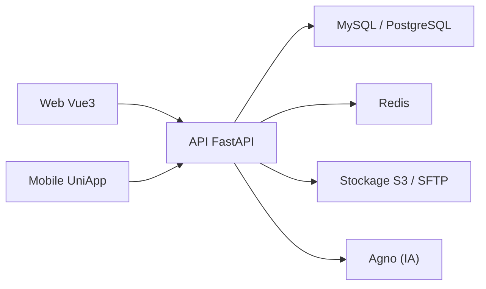

# fastapiadmin/FastapiAdmin

> Plateforme d'administration full-stack (FastAPI + Vue3 + UniApp) avec RBAC et générateur de code, documentée en chinois.

## Le problème
Monter une console d'administration avec utilisateurs, permissions, tâches planifiées et mobile prend du temps à partir de zéro.

## Ce que ça fait vraiment
Backend FastAPI (Pydantic 2, SQLAlchemy, Alembic) et web Vue3/Element Plus, mobile UniApp. Modules : système, monitoring, logs, tâches planifiées, générateur de code (table vers code), stockage (SFTP/S3/OSS/COS/OBS), conversation IA via Agno, chat interne. Plus de 200 routes REST, MySQL/PostgreSQL/SQLite. `ENABLED_MODULES` retire les modules.

## Comment c'est branché


## Essayer
```bash
cd backend && uv sync && uv run main.py run --env=dev
cd ../frontend/web && pnpm install && pnpm run dev
cp docker/.env.example docker/.env
./deploy.sh
```

## Coût et pièges
Base SQL et Redis requis. Déploiement en instance unique (WebSocket et scheduler en mémoire). Clés IA/cloud dans les `.env`, jamais commitées. Le README est en chinois.

## Ce que ce n'est pas
Le chat est du texte seul, sans fichiers ni accusés de lecture. Pas un outil data/ML : une base d'admin générique.

## Alternatives
- Django Admin : comparé dans le README (plus limité, synchrone).

## Pour toi
À surveiller : utile si tu dois emballer un service IA dans une console d'admin, mais hors du cœur data/MLOps et documenté surtout en chinois.

