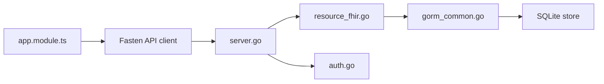

# fastenhealth/fasten-onprem

> Self-hosted personal medical record for viewing FHIR health data as a family.

## The problem
Medical history is scattered across clinics, labs and insurers, and you don't want to hand it over to a third party.

## What it actually does
Self-hosted web application (Go API, Angular interface, SQLite or PostgreSQL): you enter data or import FHIR bundles exported elsewhere, then browse dashboards and history. The README states that it does not connect directly to healthcare providers (that is the commercial product Fasten Connect). Multi-user is announced as work in progress; HTTPS with a self-generated certificate authority.

## How it is wired


## Trying it
```bash
curl https://raw.githubusercontent.com/fastenhealth/fasten-onprem/refs/heads/main/docker-compose-prod.yml -o docker-compose.yml
curl https://raw.githubusercontent.com/fastenhealth/fasten-onprem/refs/heads/main/set_env.sh -o set_env.sh
chmod +x ./set_env.sh && ./set_env.sh
docker compose up -d
```

## Cost and gotchas
Free. Docker required; self-signed certificate to import into the browser. The sample account `testuser` is mentioned in the README.

## What it is not
Not an automatic aggregator of hospital records, nor a strong security solution: the administrator sees all records. The repository is archived.

## Alternatives
OpenEMR (cited as a system for clinics, not for families).

## For you
Ignore: archived repository, GPL-3.0, and without direct import from providers, it does not deliver on its aggregation promise.
