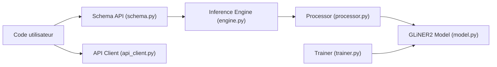

# fastino-ai/GLiNER2

> Local encoder models to extract entities, classes, relations and structured JSON through a single schema.

## The problem
Extracting entities, classifying text and filling JSON structures usually requires several models or an LLM that is costly on every call.

## What it actually does
A schema describes what you want (entities, classification, structures, relations, span attributes) and a single encoder model (DeBERTa, 74 M to 340 M parameters) answers in one pass. Runs on CPU, locally. Two architectures (span, boundary) behind `AutoExtractor`. Training and LoRA included. An API client to the hosted service exists as an option.

## How it is wired


## Trying it
```bash
pip install gliner2
pip install gliner2[train]
pip install "gliner2[local]"
```
```python
from gliner2 import AutoExtractor
model = AutoExtractor.from_pretrained("fastino/gliner2.5-base-v1")
model.extract_entities("Apple CEO Tim Cook announced iPhone 15 in Cupertino yesterday.", ["company", "person", "product", "location"])
```

## Cost and gotchas
Local is free, CPU is enough; GPU optional (fp16, FlashDeBERTa). The cloud API requires a `PIONEER_API_KEY` key. `GLiNER2.from_pretrained` does not load boundary checkpoints.

## What it is not
Not a generative LLM: it extracts spans present in the text. The README's output examples are illustrative, real accuracy depends on your domain.

## Alternatives
GLiNER, the original architecture cited in the README.

## For you
Adopt: local extraction and classification, with no GPU or per-call bill, with LoRA fine-tuning; ideal for text data pipelines.
