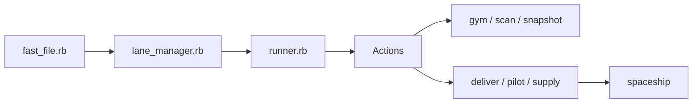

# fastlane/fastlane

> Ruby automation for building, signing, screenshotting and publishing iOS and Android apps.

## The problem
Publishing a mobile app chains together manual tasks: signing profiles, screenshots, metadata, uploads to the stores.

## What it actually does
A CLI reads a `Fastfile` (lanes) and runs actions: `gym` (build), `scan` (tests), `snapshot`/`screengrab` (screenshots), `deliver`, `pilot`, `supply` (upload to App Store, TestFlight, Google Play), `match` (encrypted signing assets stored in Git, S3 or GCS), `spaceship` (Apple API client). Swift bridge and plugins as gems.

## How it is wired

## Trying it
The README contains no useful command, apart from `fastlane env` for bug reports. The docs are at docs.fastlane.tools.

## Cost and gotchas
Free, but requires Ruby and, for Apple, macOS/Xcode and a developer account. Usage statistics are collected, with the option to opt out.

## What it is not
Not an MLOps tool nor general continuous integration.

## Alternatives
No alternative named in the README.

## For you
Ignore: it concerns mobile app deployment, outside the data/AI scope unless you publish an app.
