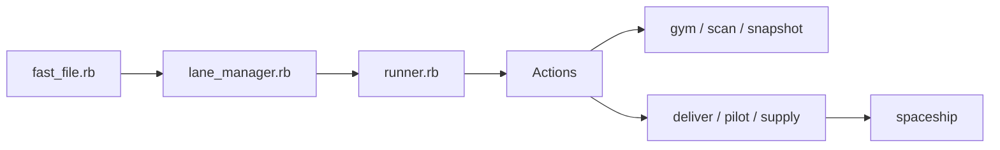

# fastlane/fastlane

> Automatisation Ruby des builds, signatures, captures et publications d'apps iOS et Android.

## Le problème
Publier une appli mobile enchaîne des tâches manuelles : profils de signature, captures d'écran, métadonnées, envoi aux stores.

## Ce que ça fait vraiment
Une CLI lit un `Fastfile` (voies/lanes), exécute des actions : `gym` (build), `scan` (tests), `snapshot`/`screengrab` (captures), `deliver`, `pilot`, `supply` (envoi App Store, TestFlight, Google Play), `match` (signatures chiffrées stockées dans Git, S3 ou GCS), `spaceship` (client API Apple). Pont Swift et plugins sous forme de gems.

## Comment c'est branché

## Essayer
Le README ne contient pas de commande utile, hors `fastlane env` pour les rapports de bogue. La doc est sur docs.fastlane.tools.

## Coût et pièges
Gratuit, mais exige Ruby et, pour Apple, macOS/Xcode et un compte développeur. Statistiques d'usage collectées avec possibilité de refus.

## Ce que ce n'est pas
Pas un outil de MLOps ni d'intégration continue générale.

## Alternatives
Aucune alternative nommée dans le README.

## Pour toi
Ignorer : concerne le déploiement d'applications mobiles, hors périmètre data/IA sauf si tu publies une appli.

