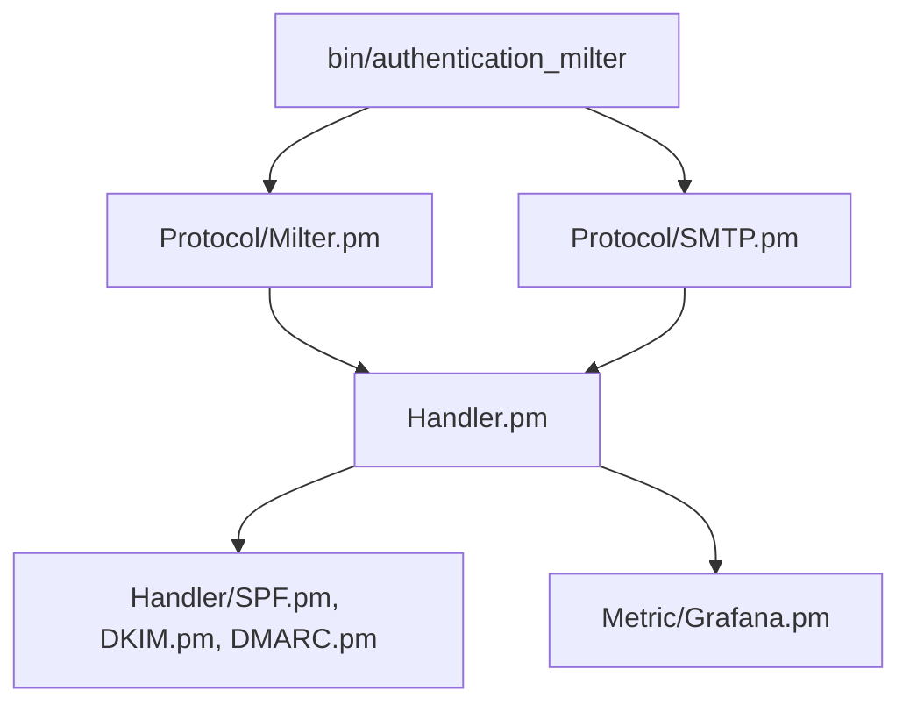

# fastmail/authentication_milter

> Perl milter that checks SPF, DKIM, DMARC, ARC and BIMI on incoming mail.

## The problem
Incoming mail must be authenticated (SPF, DKIM, DMARC) without wrongly rejecting mailing lists.

## What it actually does
A daemon runs as a milter or as a post-queue SMTP filter (Postfix). A central handler calls modules (SPF, DKIM, DMARC, IPRev, SenderID, ARC, BIMI). It adds Authentication-Results headers and stores nothing on disk. Optional Prometheus metrics and Grafana dashboard.

## How it is wired
Diagram based on the code diagram.



## Trying it
```bash
cpanm Mail::Milter::Authentication
authentication_milter --help
```

## Cost and gotchas
Free. Installed via CPAN (Perl, not listed). DMARC requires a database and `/etc/mail-dmarc.ini`. In SMTP mode, do not expose the milter to untrusted clients. License: "same as Perl", not identified by GitHub.

## What it is not
Not an antispam: it checks and annotates, without rejecting unless configured to.

## Alternatives
None cited in the README.

## For you
Ignore: a mail server administrator's tool, foreign to data / AI / MLOps work.
