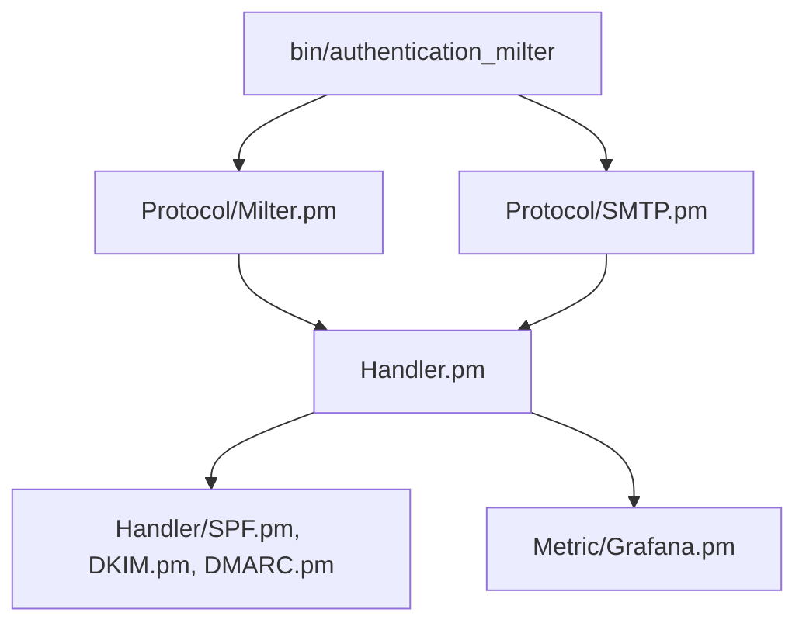

# fastmail/authentication_milter

> Milter Perl qui vérifie SPF, DKIM, DMARC, ARC et BIMI sur le courrier entrant.

## Le problème
Il faut authentifier le courrier entrant (SPF, DKIM, DMARC) sans rejeter à tort les listes de diffusion.

## Ce que ça fait vraiment
Un démon fonctionne en milter ou en filtre SMTP après file d'attente (Postfix). Un gestionnaire central appelle des modules (SPF, DKIM, DMARC, IPRev, SenderID, ARC, BIMI). Il ajoute des en-têtes Authentication-Results et ne stocke rien sur disque. Métriques Prometheus et tableau Grafana optionnels.

## Comment c'est branché
Schéma d'après le diagramme du code.



## Essayer
```bash
cpanm Mail::Milter::Authentication
authentication_milter --help
```

## Coût et pièges
Gratuit. Installation via CPAN (Perl, non listé). DMARC demande une base de données et `/etc/mail-dmarc.ini`. En mode SMTP, ne pas exposer le milter à des clients non fiables. Licence : « comme Perl », non identifiée par GitHub.

## Ce que ce n'est pas
Pas un antispam : il vérifie et annote, sans rejeter sauf configuration.

## Alternatives
Aucune citée dans le README.

## Pour toi
Ignorer : outil d'administrateur de serveur de messagerie, étranger au travail data / IA / MLOps.

