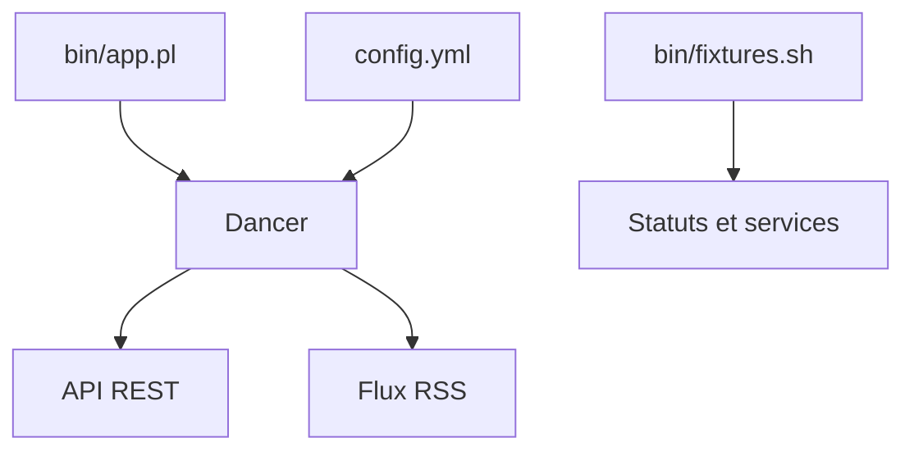

# fastmail/towncrier

> Service status dashboard in Perl, with a REST API and RSS feeds, for operators.

## The problem
Publishing the state of your services to your users normally requires a dedicated web server and database.

## What it actually does
A standalone Perl application, with no web server or external database. It exposes a REST API (including a read-only public API) and RSS feeds. Initial statuses and services are set up with `bin/fixtures.sh`, and settings live in `config.yml`. FastMail uses it for its status page.

## How it is wired
Simplified diagram based on the sheet, no diagram provided.



## Trying it
```bash
git clone http://github.com/robn/towncrier.git
cd towncrier
curl -L http://cpanmin.us | perl - Carton
carton install --deployment
carton exec plackup bin/app.pl
```

## Cost and gotchas
Free. It requires Perl, modules, the `libxml2` and `expat` development packages, `make` and `gcc`. Production deployment is left to you (Carton, Dancer::Deployment).

## What it is not
Not a monitoring tool: it displays statuses that are entered by hand, it monitors nothing. Archived repository, no further development.

## Alternatives
None cited in the README.

## For you
Ignore: repository archived since 2022, written in Perl, and unrelated to data / AI / MLOps work.
