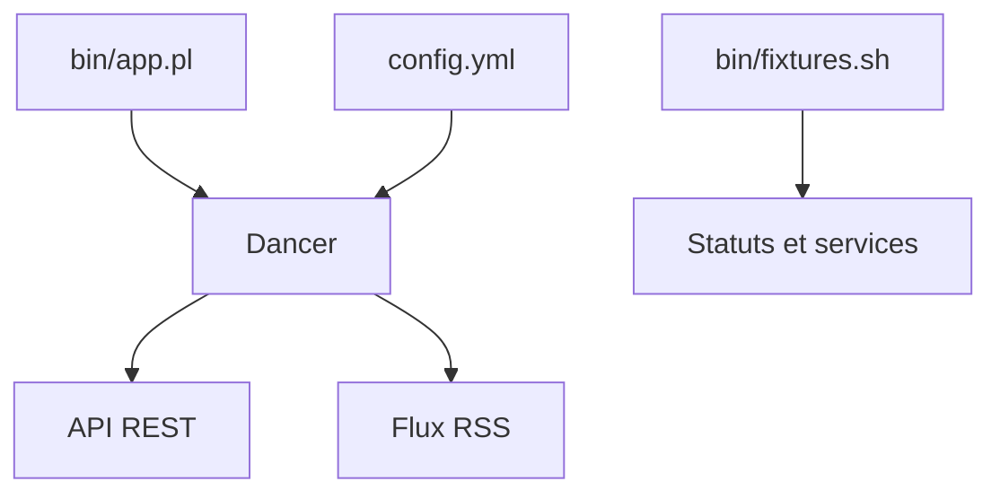

# fastmail/towncrier

> Tableau de bord de statut de services en Perl, avec API REST et flux RSS, pour exploitants.

## Le problème
Publier l'état de ses services à ses utilisateurs demande normalement un serveur web et une base de données dédiés.

## Ce que ça fait vraiment
Application Perl autonome, sans serveur web ni base externe. Elle expose une API REST (dont une API publique en lecture seule) et des flux RSS. Les statuts et services initiaux s'installent avec `bin/fixtures.sh`, les réglages sont dans `config.yml`. FastMail l'utilise pour sa page de statut.

## Comment c'est branché
Schéma simplifié d'après la fiche, sans diagramme fourni.



## Essayer
```bash
git clone http://github.com/robn/towncrier.git
cd towncrier
curl -L http://cpanmin.us | perl - Carton
carton install --deployment
carton exec plackup bin/app.pl
```

## Coût et pièges
Gratuit. Il faut Perl, des modules, les paquets de développement `libxml2` et `expat`, `make` et `gcc`. Le déploiement en production est laissé à toi (Carton, Dancer::Deployment).

## Ce que ce n'est pas
Pas un outil de supervision : il affiche des statuts saisis, il ne surveille rien. Dépôt archivé, plus aucune évolution.

## Alternatives
Aucune citée dans le README.

## Pour toi
À ignorer : dépôt archivé depuis 2022, écrit en Perl, et sans rapport avec un travail data / IA / MLOps.

