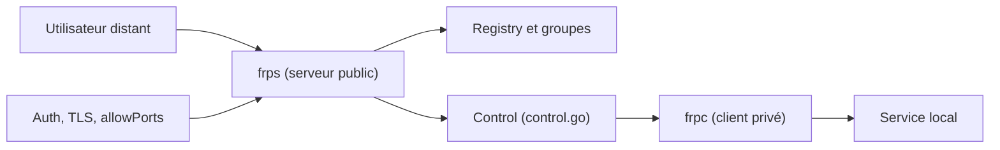

# fatedier/frp

> A reverse proxy that exposes a local service sitting behind a NAT or firewall to the Internet.

## The problem
A server without a public IP (dev workstation, GPU machine on a LAN) is not reachable from outside without opening ports or setting up a VPN.

## What it actually does
Two binaries: `frps` on a machine with a public IP, `frpc` on the private machine. The client opens a control connection to the server, then the TCP, UDP, HTTP, HTTPS, tcpmux, STCP (shared key) and XTCP (P2P) proxies relay the traffic. Options: dashboard, Prometheus, token or OIDC authentication, TLS enabled by default, bandwidth limiting, plugins and an SSH gateway.

## How it is wired


## Trying it
```bash
./frps -c ./frps.toml
./frpc -c ./frpc.toml
ssh -oPort=6000 test@x.x.x.x
```
With `bindPort = 7000` on the server side, then `serverAddr`, `serverPort` and a proxy `type = "tcp"` on the client side (README example).

## Cost and gotchas
Free, but you need a machine with a public IP. The README warns that some antivirus programs classify `frpc` as malware. Its dashboard example uses admin/admin: change it. Exposing an SSH port to the Internet requires a token, TLS and `allowPorts`. Version 2 is announced as incompatible with v1.

## What it is not
Neither a full VPN (VirtualNet is an alpha feature) nor a managed service. Development depends on one person available part-time.

## Alternatives
- gofrp/tiny-frpc: a lightweight client of about 3.5 MB for resource-constrained devices.
- gofrp/plugin: a plugin repository to extend frp.

## For you
Adopt: gives access to a notebook or a GPU machine at home through a public server, provided you enable token and TLS.
