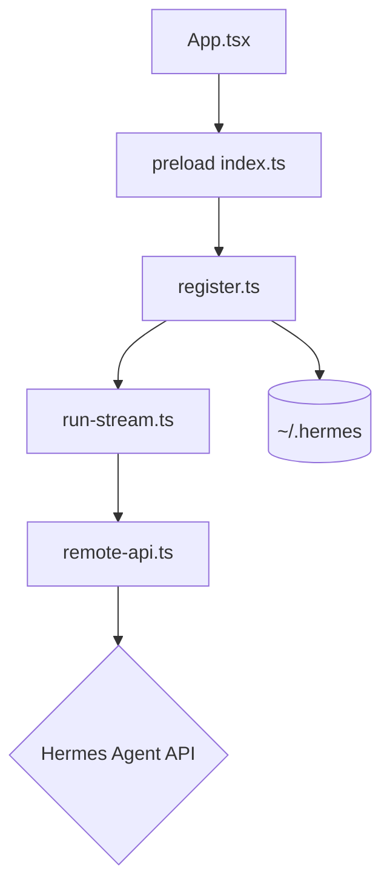

# fathah/hermes-desktop

> Community desktop application to install, configure and chat with Hermes Agent, an AI assistant.

## The problem
Hermes Agent is used from the command line: installation, providers, profiles and messaging gateways are all managed by hand.

## What it actually does
Electron application that runs the official Hermes installer into `~/.hermes`, then provides an interface for streaming chat, sessions, profiles, memory, skills, tools, scheduled tasks and 16 messaging gateways. Works locally (127.0.0.1:8642) or against a remote server. Supports many LLM providers (OpenRouter, Anthropic, OpenAI, Ollama, vLLM, etc.). Secrets can come from an external helper (pass, KeePassXC, etc.).

## How it is wired


## Trying it
```bash
sudo dnf install ./hermes-desktop-<version>.rpm
```
Otherwise the README points to the download at hermesone.org or the GitHub Releases.

## Cost and gotchas
Provider API keys are at your expense (except local models). Unsigned Windows installer; RPM not GPG-signed. No automatic update for the RPM.

## What it is not
Not the agent itself: it depends on the upstream Hermes Agent project, and it is not affiliated with Nous Research. The project is under active development and may break.

## Alternatives
- NousResearch/hermes-agent: the core of the agent, command line, without the interface.

## For you
Worth watching: handy if you already use Hermes Agent, of no interest otherwise, and still unstable.
