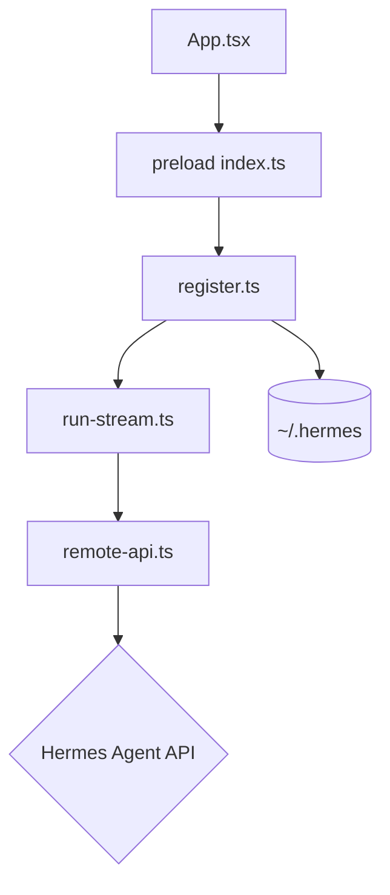

# fathah/hermes-desktop

> Application bureau communautaire pour installer, configurer et dialoguer avec Hermes Agent, un assistant IA.

## Le problème
Hermes Agent s'utilise en ligne de commande : installation, fournisseurs, profils et passerelles de messagerie se gèrent à la main.

## Ce que ça fait vraiment
Application Electron qui lance l'installateur officiel d'Hermes dans `~/.hermes`, puis donne une interface pour le chat en streaming, les sessions, profils, mémoire, skills, outils, tâches planifiées et 16 passerelles de messagerie. Fonctionne en local (127.0.0.1:8642) ou contre un serveur distant. Gère de nombreux fournisseurs de LLM (OpenRouter, Anthropic, OpenAI, Ollama, vLLM, etc.). Les secrets peuvent venir d'un assistant externe (pass, KeePassXC, etc.).

## Comment c'est branché


## Essayer
```bash
sudo dnf install ./hermes-desktop-<version>.rpm
```
Le README renvoie sinon au téléchargement depuis hermesone.org ou les Releases GitHub.

## Coût et pièges
Clés d'API de fournisseurs à ta charge (sauf modèles locaux). Installateur Windows non signé ; RPM non signé GPG. Pas de mise à jour automatique pour le RPM.

## Ce que ce n'est pas
Pas l'agent lui-même : il dépend du projet amont Hermes Agent, dont il n'est pas affilié à Nous Research. Le projet est en développement actif et peut casser.

## Alternatives
- NousResearch/hermes-agent : le cœur de l'agent, en ligne de commande, sans l'interface.

## Pour toi
À surveiller : pratique si tu utilises déjà Hermes Agent, sans intérêt autrement, et encore instable.

