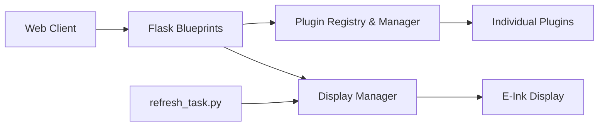

# fatihak/InkyPi

> E-ink display on a Raspberry Pi driven by a web interface, with plugins to show weather, calendar or images.

## The problem
Displaying information without a bright screen, notifications or noise, on an e-ink frame configurable from any device on the network.

## What it is not
See below. First, how it works.

## What it actually does
A Python application (Flask-style blueprints) starts via `inkypi.py`, serves a web interface, loads plugins listed in a registry (clock, weather, calendar, newspaper/comics, image upload, text/image AI via OpenAI) and refreshes the screen through a scheduled task via a display manager. Playlists schedule the plugins by time slots. The installation scripts enable SPI and I2C.

## How it is wired


## Trying it
```bash
git clone https://github.com/fatihak/InkyPi.git
cd InkyPi
sudo bash install/install.sh
sudo bash install/update.sh
```

## Cost and gotchas
Hardware: Raspberry Pi (4, 3 or Zero 2 W), microSD card, Inky or Waveshare display (some IT8951 models not supported). The AI plugin uses OpenAI models: key and bill at your expense. Affiliate links in the README.

## What it is not
Not a turnkey product: it is a tinkerer's project, with known issues on Pi Zero W. The AI plugin is just one plugin among others.

## Alternatives
No alternative named in the README.

## For you
Ignore: hobby hardware project, unrelated to data or AI pipelines, unless you want a personal e-ink dashboard.
