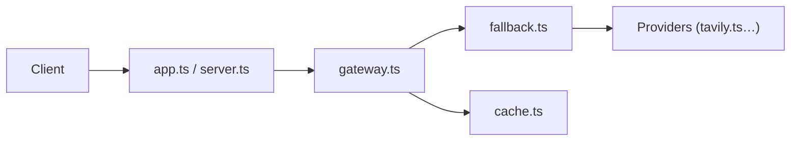

# fatwang2/search2ai

> Self-hosted, Perplexity-compatible search gateway with provider fallback, for AI agents.

## The problem
Each search API has its own schema and limits; when one goes down, the agent has no search left.

## What it actually does
Normalizes `search`, `news` and `crawl` into a single schema (`title/url/snippet/date`). Tries the configured providers in order (Search1API, Tavily, Brave, Exa, Serper, SerpApi, Google, SearXNG, Jina, Firecrawl) and falls back on error, rate limit or timeout, reporting the skipped providers. Usable as a library, HTTP server, MCP server, Cloudflare Workers or Docker. The old chat proxy with search tools is kept as an option.

## How it is wired


## Trying it
```bash
npm i search2ai
SEARCH1API_KEY=your_key npx search2ai serve
curl http://localhost:3014/v1/search -H 'Content-Type: application/json' -d '{"query": "latest node.js lts", "max_results": 3}'
```

## Cost and gotchas
One key per provider used ("bring your own key"). Search1API, a service by the same authors, is placed first in the chain by default. Empty results do not trigger fallback unless `FALLBACK_ON_EMPTY=true`.

## What it is not
Not a search engine nor a keyless scraper. Advanced reliability (key rotation, circuit breaker) is on the v0.4 roadmap.

## Alternatives
No alternative named in the README.

## For you
Worth watching: useful to make an agent's search more reliable via MCP or HTTP; single maintainer and an in-house provider is favored.
