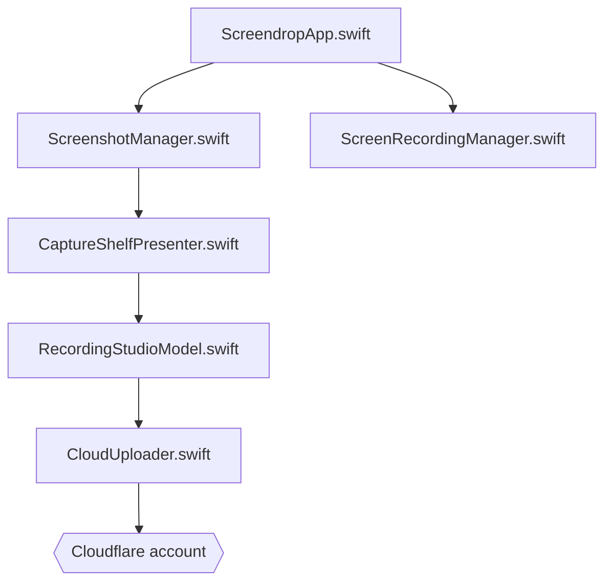

# fayazara/Screendrop

> Native macOS screen capture and recording app, a self-hosted alternative to Loom.

## The problem
Capturing, annotating, editing and sharing screens and videos requires several tools, often paid or hosted by a third party.

## What it actually does
Screenshot of the screen, a window or an area, local OCR, non-destructive annotations with smart masking, screen, camera, microphone and system audio recording. The Studio adds automatic zooms, a reconstructed cursor, subtitles, transcript-based editing (local Apple speech recognition) and export. Sharing goes through your own Cloudflare account (Worker, R2, D1).

## How it is wired


## Trying it
```bash
brew install --cask fayazara/tap/screendrop
npx wrangler secret put UPLOAD_TOKEN
```

## Cost and gotchas
macOS 26.4 minimum. Sharing requires a Cloudflare account of your own. macOS permissions: screen recording, camera, microphone, input monitoring. The README announces active development with possible breaking changes and no automated tests (compilation serves as the check).

## What it is not
Not a cross-platform tool nor a hosted service: there is no central Screendrop account. FFmpeg is required for video compression.

## Alternatives
Loom, cited in the README as the tool it replaces.

## For you
Ignore: a macOS capture app unrelated to data/AI/MLOps; CC0 is permissive, but the project has a single maintainer.
