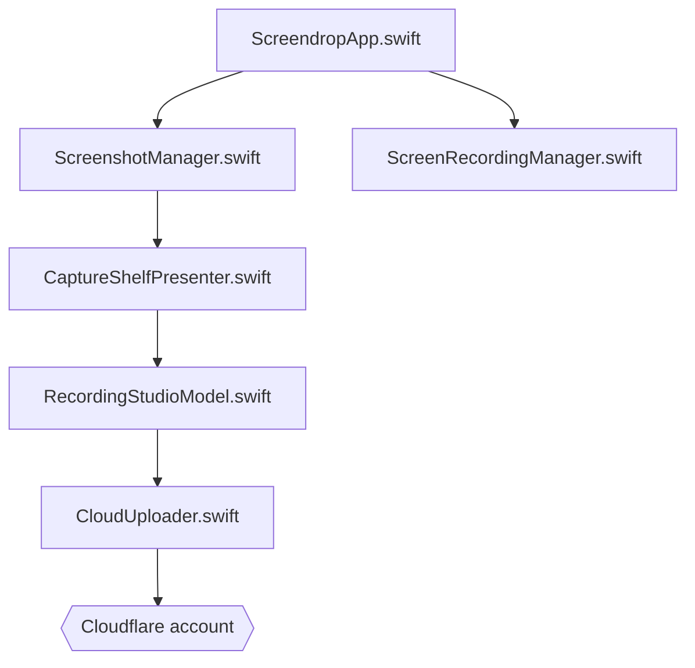

# fayazara/Screendrop

> App macOS native de capture et d'enregistrement d'écran, alternative auto-hébergée à Loom.

## Le problème
Capturer, annoter, monter et partager écrans et vidéos demande plusieurs outils, souvent payants ou hébergés chez un tiers.

## Ce que ça fait vraiment
Capture d'écran, de fenêtre ou de zone, OCR local, annotations non destructives avec masquage intelligent, enregistrement écran, caméra, micro et son système. Le Studio ajoute zooms automatiques, curseur reconstruit, sous-titres, montage par transcription (reconnaissance vocale Apple locale) et export. Le partage passe par ton compte Cloudflare (Worker, R2, D1).

## Comment c'est branché


## Essayer
```bash
brew install --cask fayazara/tap/screendrop
npx wrangler secret put UPLOAD_TOKEN
```

## Coût et pièges
macOS 26.4 minimum. Le partage exige un compte Cloudflare à toi. Permissions macOS : enregistrement d'écran, caméra, micro, surveillance des entrées. Le README annonce un développement actif avec des ruptures possibles et aucun test automatisé (la compilation sert de contrôle).

## Ce que ce n'est pas
Pas un outil multiplateforme ni un service hébergé : aucun compte Screendrop central. FFmpeg est requis pour la compression de vidéos.

## Alternatives
Loom, cité dans le README comme l'outil qu'il remplace.

## Pour toi
Ignorer : app de capture macOS sans rapport avec data/IA/MLOps ; CC0 est permissif, mais le projet est mono-mainteneur.

