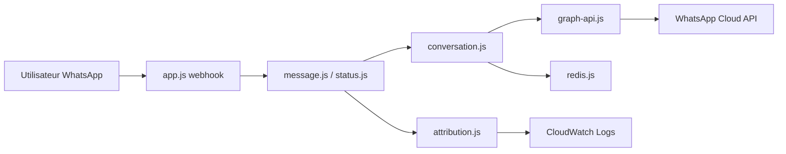

# fbsamples/whatsapp-business-jaspers-market

> WhatsApp Business demo bot for a fictional grocery store, to copy in order to build your own customer journey.

## The problem
Wiring up a WhatsApp webhook, interactive messages and templates with media requires reading a lot of Meta documentation. Here, a complete, runnable example.

## What it actually does
A Node server receives WhatsApp webhooks, normalizes messages and statuses, then routes reply buttons to grocery, offer or recipe responses (templates with an image carousel). After the delivered/read statuses, Redis is used to send a follow-up. Entry attribution is logged to CloudWatch Logs.

## How it is wired


## Trying it
```bash
git clone git@github.com:fbsamples/whatsapp-business-jaspers-market.git
cd whatsapp-business-jaspers-market
redis-server --daemonize yes
npm install
cp .sample.env .env
./template.sh
node app.js
npm test
```
Plus `ngrok http 8080` to expose the webhook.

## Cost and gotchas
A Meta developer account, a Meta app, Meta Business and a WhatsApp Business account are mandatory. Four media IDs to upload, valid for 30 days. Redis and a tunnel (ngrok) required. The application refuses to start if an ID is missing.

## What it is not
Not a production-ready bot nor a reusable framework: it is an educational example tied to the Meta platform. No AI or LLM here.

## Alternatives
No alternative cited in the README.

## For you
Worth watching: useful if you need to prototype a WhatsApp channel in front of an agent, but with no AI and locked to Meta, it adds nothing for a data/MLOps profile.
