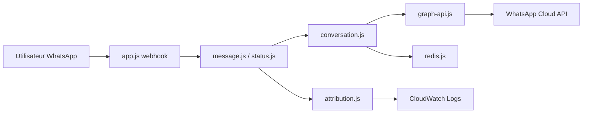

# fbsamples/whatsapp-business-jaspers-market

> Bot de démonstration WhatsApp Business pour une épicerie fictive, à copier pour construire son propre parcours client.

## Le problème
Brancher un webhook WhatsApp, des messages interactifs et des templates avec médias demande de lire beaucoup de documentation Meta. Ici, un exemple complet et exécutable.

## Ce que ça fait vraiment
Un serveur Node reçoit les webhooks WhatsApp, normalise messages et statuts, puis route les boutons de réponse vers des réponses grocery, offre ou recette (templates avec carrousel d'images). Après les statuts livré/lu, Redis sert à envoyer une relance. L'attribution des entrées est journalisée vers CloudWatch Logs.

## Comment c'est branché


## Essayer
```bash
git clone git@github.com:fbsamples/whatsapp-business-jaspers-market.git
cd whatsapp-business-jaspers-market
redis-server --daemonize yes
npm install
cp .sample.env .env
./template.sh
node app.js
npm test
```
Plus `ngrok http 8080` pour exposer le webhook.

## Coût et pièges
Compte développeur Meta, app Meta, Meta Business et compte WhatsApp Business obligatoires. Quatre IDs de média à téléverser, valables 30 jours. Redis et un tunnel (ngrok) requis. L'application refuse de démarrer si un ID est manquant.

## Ce que ce n'est pas
Pas un bot prêt pour la production ni un framework réutilisable : c'est un exemple pédagogique lié à la plateforme Meta. Pas d'IA ni de LLM ici.

## Alternatives
Aucune alternative citée dans le README.

## Pour toi
À surveiller : utile si tu dois prototyper un canal WhatsApp devant un agent, mais sans IA et verrouillé sur Meta, il n'apporte rien de plus à un profil data/MLOps.

