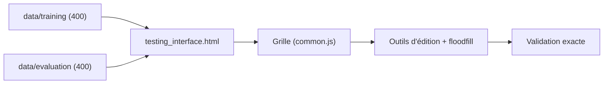

# fchollet/ARC-AGI

> ARC-AGI-1 task set and a web interface to solve them by hand; for AI reasoning researchers.

## The problem
Measuring a form of fluid intelligence requires a benchmark of novel tasks, solved from few examples.

## What it actually does
The repository holds 400 training tasks and 400 evaluation tasks in JSON format: each task has `train` pairs (demonstrations) and `test` pairs, with grids from 1x1 to 30x30 of integers 0 to 9. An HTML interface (`apps/testing_interface.html`) lets you load a task, edit the grid (resize, copy, select, fill) and submit: only the exact grid counts, 3 attempts in principle (not enforced by the interface).

## How it is wired


## Trying it
```bash
# Aucune commande : ouvrir apps/testing_interface.html dans un navigateur
# (Chrome recommandé) et charger un fichier de tâche JSON.
```

## Cost and gotchas
Free, no dependencies. Do not look at or optimize on the evaluation set during development, or you risk leakage. Last push in April 2025.

## What it is not
This is version 1 of the benchmark; the README points to an ARC-AGI-2 repository. Not a solver or a leaderboard.

## Alternatives
ARC-AGI-2 (separate repository mentioned in the README).

## For you
Useful for testing the reasoning of an LLM or a program synthesizer on a well-known benchmark; for recent work, look at version 2 instead.
