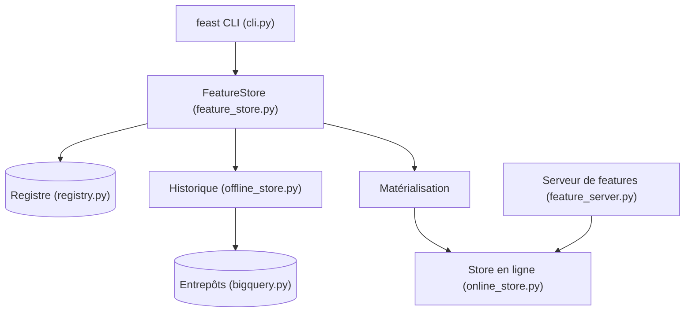

# feast-dev/feast

> Open-source feature store for ML teams: the same features at training time and in online inference.

## The problem
The features computed for training are not the ones served in production, and historical joins leak the future into the model.

## What it actually does
Feast registers feature definitions in a registry, then performs "point-in-time" joins on an offline store (BigQuery, DuckDB, Snowflake, Spark…). It then materializes the values to an online store (Redis, DynamoDB, Postgres…) and serves them through a feature server. The Python SDK and the `feast` CLI are the entry point; Go and Java servers also exist.

## How it is wired


## Trying it
```bash
pip install feast
feast init my_feature_repo
cd my_feature_repo/feature_repo
feast apply
feast ui
feast materialize-incremental $CURRENT_TIME
```

## Cost and gotchas
Free, but in practice you need to plug in an offline store and an online store, so infrastructure is at your expense. The `feast ui` web interface is marked experimental.

## What it is not
Not a feature computation tool on its own: it orchestrates, it does not replace your transformation pipeline. Nor is it a data warehouse.

## Alternatives
No alternative cited in the README.

## For you
Adopt it as soon as you have models served in real time: the point-in-time join prevents data leakage and the project is active (last push 2026-10-19).
