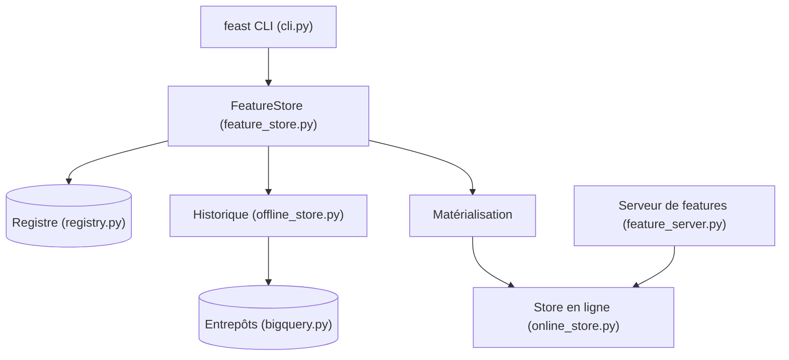

# feast-dev/feast

> Magasin de features open source pour équipes ML : mêmes features à l'entraînement et en inférence en ligne.

## Le problème
Les features calculées pour l'entraînement ne sont pas celles servies en production, et les jointures historiques laissent fuiter le futur dans le modèle.

## Ce que ça fait vraiment
Feast enregistre les définitions de features dans un registre, puis fait des jointures « point dans le temps » sur un store hors ligne (BigQuery, DuckDB, Snowflake, Spark…). Il matérialise ensuite les valeurs vers un store en ligne (Redis, DynamoDB, Postgres…) et les sert via un serveur de features. Le SDK Python et la CLI `feast` sont le point d'entrée ; des serveurs Go et Java existent aussi.

## Comment c'est branché


## Essayer
```bash
pip install feast
feast init my_feature_repo
cd my_feature_repo/feature_repo
feast apply
feast ui
feast materialize-incremental $CURRENT_TIME
```

## Coût et pièges
Gratuit, mais il faut en pratique brancher un store hors ligne et un store en ligne, donc de l'infrastructure à ta charge. L'interface web `feast ui` est marquée expérimentale.

## Ce que ce n'est pas
Pas un outil de calcul de features à lui seul : il orchestre, il ne remplace pas ton pipeline de transformation. Ce n'est pas un entrepôt de données non plus.

## Alternatives
Aucune alternative citée dans le README.

## Pour toi
À adopter dès que tu as des modèles servis en temps réel : le point-in-time join évite la fuite de données et le projet est actif (dernier push 2026-10-19).

