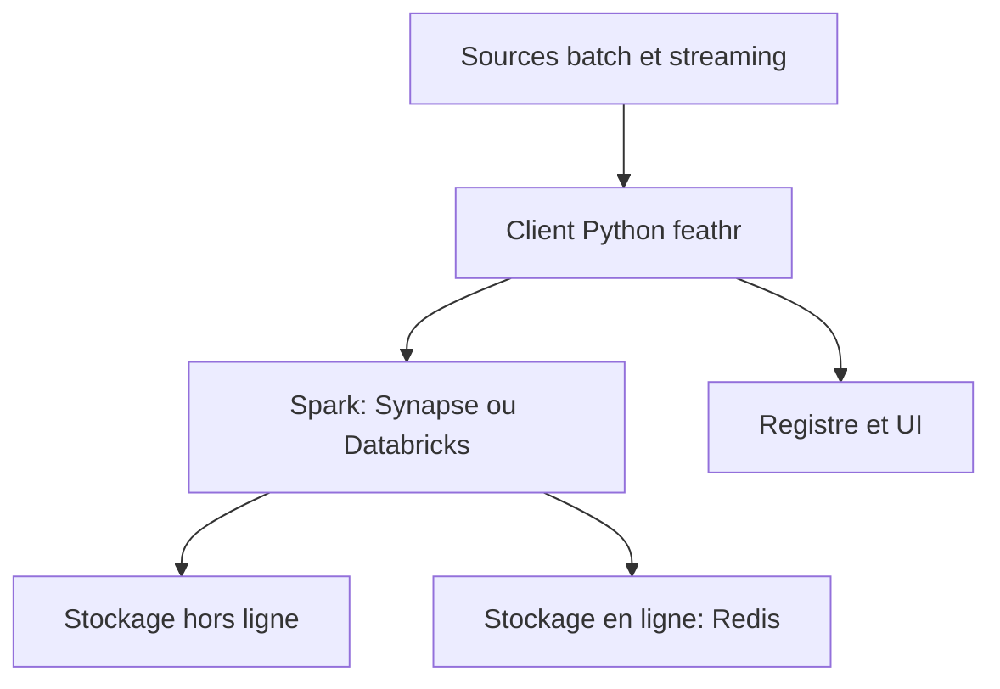

# feathr-ai/feathr

> Feature store and data engineering platform for ML, originating from LinkedIn and hosted by LF AI & Data.

## The problem
Computing consistent features for training and production, without temporal leakage, is slow and duplicated across teams.

## What it actually does
Feathr defines transformations in Python (window aggregations, derived features, PySpark UDFs), registers them by name in a registry with a search interface and lineage, then joins them to training data with point-in-time correction. It materializes to online storage (Redis, Cosmos DB). Compute engines: Azure Synapse, Databricks or local Spark.

## How it is wired
Simplified diagram based on the sheet, no diagram provided.


## Trying it
```bash
docker run -it --rm -p 8888:8888 -p 8081:80 -p 7080:7080 -e GRANT_SUDO=yes feathrfeaturestore/feathr-sandbox:releases-v1.0.0
pip install feathr
```

## Cost and gotchas
Free, but going to production requires cloud services (Azure Synapse, Databricks, Purview, Key Vault) billed separately. Last push in April 2024 and 165 open issues.

## What it is not
Not a visibly active project today, despite the "six years in production at LinkedIn". The Docker sandbox does not replace a cloud deployment.

## Alternatives
No alternative named in the README.

## For you
Worth watching: a solid approach to features with point-in-time correction, but the repository has been silent since 2024 and is tied to the Azure ecosystem.
