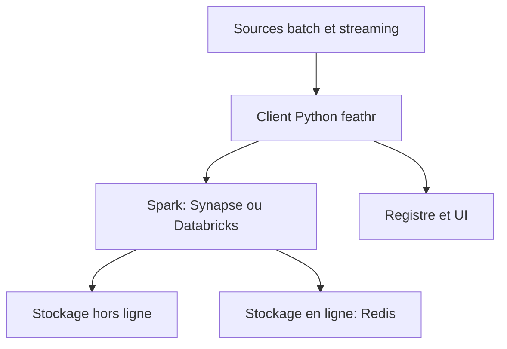

# feathr-ai/feathr

> Magasin de features et plateforme d'ingénierie de données pour ML, issu de LinkedIn et hébergé par LF AI & Data.

## Le problème
Calculer des features cohérentes pour l'entraînement et la production, sans fuite temporelle, est long et dupliqué entre équipes.

## Ce que ça fait vraiment
Feathr définit des transformations en Python (agrégations sur fenêtre, features dérivées, UDF PySpark), les enregistre par nom dans un registre avec interface de recherche et lignage, puis les joint aux données d'entraînement avec correction temporelle. Il matérialise vers un stockage en ligne (Redis, Cosmos DB). Moteurs de calcul : Azure Synapse, Databricks ou Spark local.

## Comment c'est branché
Schéma simplifié d'après la fiche, sans diagramme fourni.


## Essayer
```bash
docker run -it --rm -p 8888:8888 -p 8081:80 -p 7080:7080 -e GRANT_SUDO=yes feathrfeaturestore/feathr-sandbox:releases-v1.0.0
pip install feathr
```

## Coût et pièges
Gratuit, mais la mise en production suppose des services cloud (Azure Synapse, Databricks, Purview, Key Vault) facturés à part. Dernier push en avril 2024 et 165 issues ouvertes.

## Ce que ce n'est pas
Ce n'est pas un projet visiblement actif aujourd'hui, malgré les « six ans en production chez LinkedIn ». Le bac à sable Docker ne remplace pas un déploiement cloud.

## Alternatives
Aucune alternative nommée dans le README.

## Pour toi
À surveiller : approche solide des features avec correction temporelle, mais le dépôt est silencieux depuis 2024 et lié à l'écosystème Azure.

