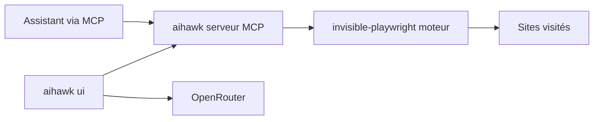

# feder-cr/Jobs_Applier_AI_Agent

> Agent-driven anti-detection browser, with an MCP server, to automate the web without being blocked.

## The problem
Agents that drive a browser get blocked (captchas, bot detection) on sites that have no API.

## What it actually does
The current README presents AIHawk as a stealth browser (Firefox engine) and a web agent: either an MCP server for Claude Code, Codex or Gemini CLI, or a local web interface (port 8765) with an OpenRouter key. Options: proxy, identity seed, persistent profile. The repository was originally called an automatic job application agent; the diagram provided still describes that former tool (main.py, YAML, summaries/cover letters), which contradicts the README.

## How it is wired


## Trying it
```bash
curl -LsSf https://astral.sh/uv/install.sh | sh
uvx invisible-playwright fetch
claude mcp add --scope user stealth -- uvx aihawk
```
```bash
uvx aihawk ui --openrouter-key sk-or-...
```

## Cost and gotchas
OpenRouter key at your expense. Each launch fetches a counter file from GitHub (IP visible). The interface has no authentication if you change the host. The key passed as an argument stays in the shell history.

## What it is not
Not the job application agent described by the old diagram. The "without being blocked" label is not a guarantee: the README reminds you to respect the sites' terms.

## Alternatives
The README points to a wiki comparison with browser-use and Operator-type agents, with no detail read here.

## For you
Ignore for now: usage centered on bypassing detection, single maintainer and a repository whose identity has changed; if you need web automation, prefer a tool with a clear scope.
