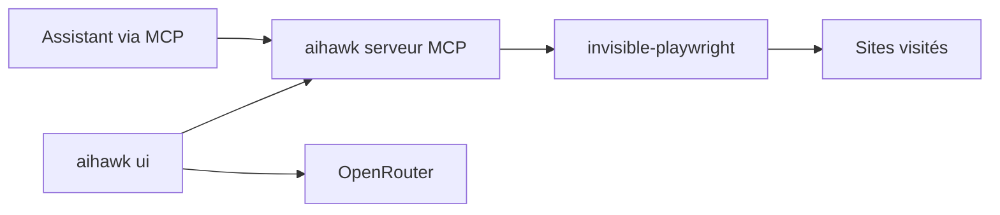

# feder-cr/Jobs_Applier_AI_Agent_AIHawk

> Same project as the previous repository: agent-driven stealth browser, with an MCP server.

## The problem
Agents that drive a browser get blocked by sites without an API (captchas, bot detection).

## What it actually does
README strictly identical to that of `feder-cr/Jobs_Applier_AI_Agent` (same stars, same creation date, same issues): it is the same repository under another name. AIHawk serves a stealth Firefox engine via an MCP server or a local interface on port 8765 with an OpenRouter key. The provided diagram describes the old job-application tool (main.py, config.py, llm_manager, resume_and_cover_builder), contradicting the README.

## How it is wired


## Trying it
```bash
uvx invisible-playwright fetch
codex mcp add stealth -- uvx aihawk
```
```bash
uvx aihawk ui --openrouter-key sk-or-...
```

## Cost and gotchas
OpenRouter key at your expense; a counter file is downloaded at every launch (your IP is visible to GitHub); interface without authentication if the host is changed.

## What it is not
Not a second project: duplicate of the previous one. Not the old job-application agent, despite the repository name.

## Alternatives
Wiki comparison cited (browser-use, Operator-type agents), not detailed.

## For you
Ignore: duplicate of an already discarded repository, centered on bypassing detection, with a single maintainer.
