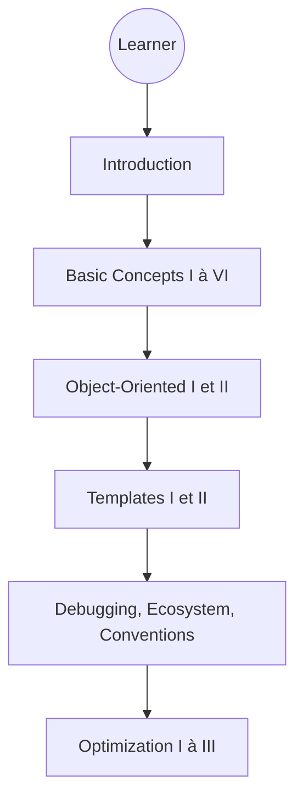

# federico-busato/Modern-CPP-Programming

> Free modern C++ course in 29 lessons, for those who already know C and object-oriented programming.

## The problem
C++ courses often stop at C++11. The new features (C++20, 23, 26), tooling and optimization are scattered.

## What it actually does
Offers 29 lessons (more than 2000 slides): basics, objects, templates, translation units, conventions, debugging and testing, CMake, containers, optimization, binary size, compilation time. Examples are short and focused. The software design lessons are marked "DRAFT".

## How it is wired
Simplified diagram based on the fiche: a reading path, not a program.

## Trying it
No documented command: read the lessons in HTML or the PDF `modern-cpp.pdf` (may be a few commits behind).

## Cost and gotchas
Free, nothing to install. The README announces a move from LaTeX to Typst, so the shape of the repository may change.

## What it is not
Not a course for programming beginners. Not software or a library.

## Alternatives
No alternative named in the README.

## For you
Worth watching: useful if you touch performance C++ (CUDA, inference, bindings), but of no direct interest otherwise.
