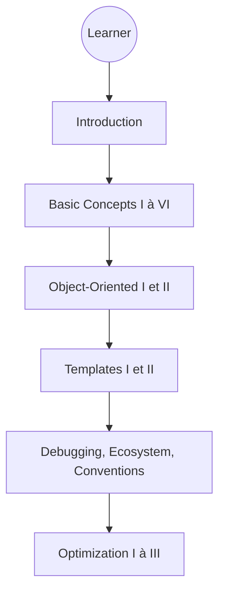

# federico-busato/Modern-CPP-Programming

> Cours libre de C++ moderne en 29 leçons, pour qui connaît déjà C et la programmation objet.

## Le problème
Les cours de C++ s'arrêtent souvent à C++11. Les nouveautés (C++20, 23, 26), les outils et l'optimisation sont dispersés.

## Ce que ça fait vraiment
Propose 29 leçons (plus de 2000 diapositives) : bases, objet, templates, unités de traduction, conventions, débogage et tests, CMake, conteneurs, optimisation, taille de binaire, temps de compilation. Les exemples sont courts et ciblés. Les leçons de conception logicielle sont marquées « DRAFT ».

## Comment c'est branché
Schéma simplifié d'après la fiche : un parcours de lecture, pas un programme.

## Essayer
Aucune commande documentée : lire les leçons en HTML ou le PDF `modern-cpp.pdf` (peut avoir quelques commits de retard).

## Coût et pièges
Gratuit, rien à installer. Le README annonce un passage de LaTeX à Typst, donc la forme du dépôt peut bouger.

## Ce que ce n'est pas
Ce n'est pas un cours pour débutants en programmation. Ce n'est pas un logiciel ni une bibliothèque.

## Alternatives
Aucune alternative nommée dans le README.

## Pour toi
À surveiller : utile si tu touches à du C++ de performance (CUDA, inférence, bindings), mais sans intérêt direct sinon.

