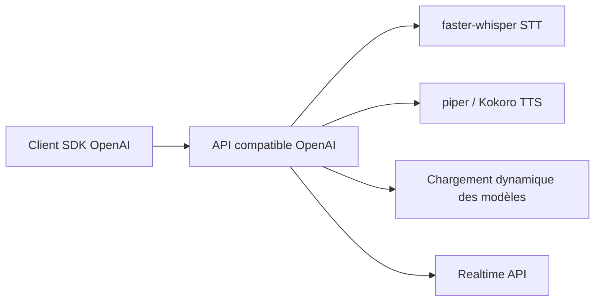

# fedirz/faster-whisper-server

> OpenAI API-compatible server for transcription, translation and speech synthesis, renamed Speaches.

## The problem
Plugging local speech recognition and synthesis into tools that already speak the OpenAI API means writing your own server layer.

## What it actually does
OpenAI-compatible server for streaming transcription (SSE) with faster-whisper, translation and synthesis (piper and Kokoro). Dynamic loading and unloading of models depending on the request and on idleness, realtime API, chat endpoint with audio input or output. CPU or GPU, Docker deployment. The project aims to be an "Ollama for voice".

## How it is wired

Diagram based on the README, with no code architecture provided.

## Trying it
No command in the README: installation and usage are on speaches.ai.

## Cost and gotchas
Free, entirely local. The GPU is optional but useful. Models are downloaded on the first request. Streaming demo marked "TODO". The repo has been renamed (Speaches); the catalogue name is the old one.

## What it is not
Not a hosted service. Not 100% of the OpenAI surface: the README says it "should work" with the SDKs.

## Alternatives
No alternative named in the README (Ollama is cited as an inspiration, for LLMs).

## For you
Adopt: a simple local building block for voice in MLOps or agent prototypes, with an already standard API and no bill.
