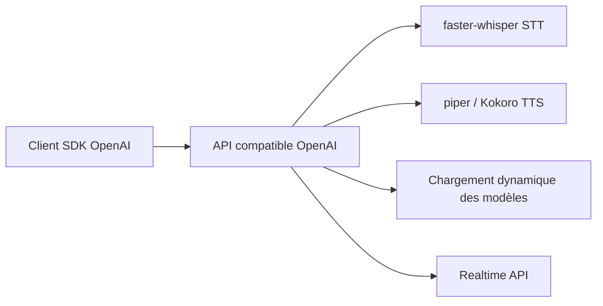

# fedirz/faster-whisper-server

> Serveur compatible API OpenAI pour transcription, traduction et synthèse vocale, rebaptisé Speaches.

## Le problème
Brancher la reconnaissance et la synthèse vocales locales sur des outils qui parlent déjà l'API OpenAI demande d'écrire sa propre couche serveur.

## Ce que ça fait vraiment
Serveur compatible OpenAI pour la transcription en continu (SSE) avec faster-whisper, la traduction et la synthèse (piper et Kokoro). Chargement et déchargement dynamiques des modèles selon la requête et l'inactivité, API temps réel, endpoint de chat avec audio en entrée ou sortie. CPU ou GPU, déploiement Docker. Le projet se veut un « Ollama pour la voix ».

## Comment c'est branché

Schéma d'après le README, sans architecture du code fournie.

## Essayer
Aucune commande dans le README : installation et usage sur speaches.ai.

## Coût et pièges
Gratuit, tout en local. Le GPU est optionnel mais utile. Les modèles se téléchargent à la première requête. Démo en streaming marquée « TODO ». Le dépôt a changé de nom (Speaches) ; le nom catalogue est l'ancien.

## Ce que ce n'est pas
Pas un service hébergé. Pas 100 % de la surface OpenAI : le README dit « devrait fonctionner » avec les SDK.

## Alternatives
Aucune alternative nommée dans le README (Ollama est cité comme modèle d'inspiration, pour les LLM).

## Pour toi
Adopter : brique locale simple pour la voix en MLOps ou prototypes d'agents, avec une API déjà standard et sans facture.

