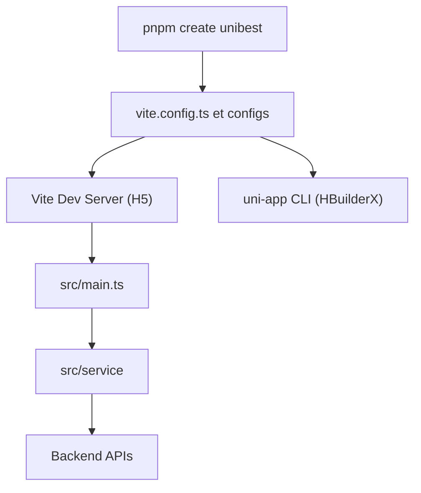

# feige996/unibest

> uni-app project template (Vue 3, TypeScript, Vite) for web, mini-programs and mobile apps.

## The problem
Starting a cross-platform uni-app project means assembling routing, requests, styles and tooling without HBuilderX.

## What it actually does
A uni-app scaffold with Vue 3, TypeScript, Vite 5, UnoCSS, wot-ui and z-paging, launched from the command line. It provides convention-based routing, layouts, request wrapping, login interception and i18n. It targets H5, mini-programs (WeChat, Alipay, ByteDance and others) and apps. The README is in Chinese.

## How it is wired


## Trying it
```bash
pnpm create unibest
pnpm i
pnpm dev
pnpm dev:mp
pnpm build:h5
```

## Cost and gotchas
Free. Node 18 or later and pnpm 7.30 or later are required; App builds go through HBuilderX. The repository has moved: PRs go to feige996.

## What it is not
It is not yet another framework: it is a template on top of uni-app. The supported platforms depend on the chosen UI library.

## Alternatives
No alternative named in the README.

## For you
Ignore: useful only for Chinese mini-programs, unrelated to data, AI or MLOps work.
