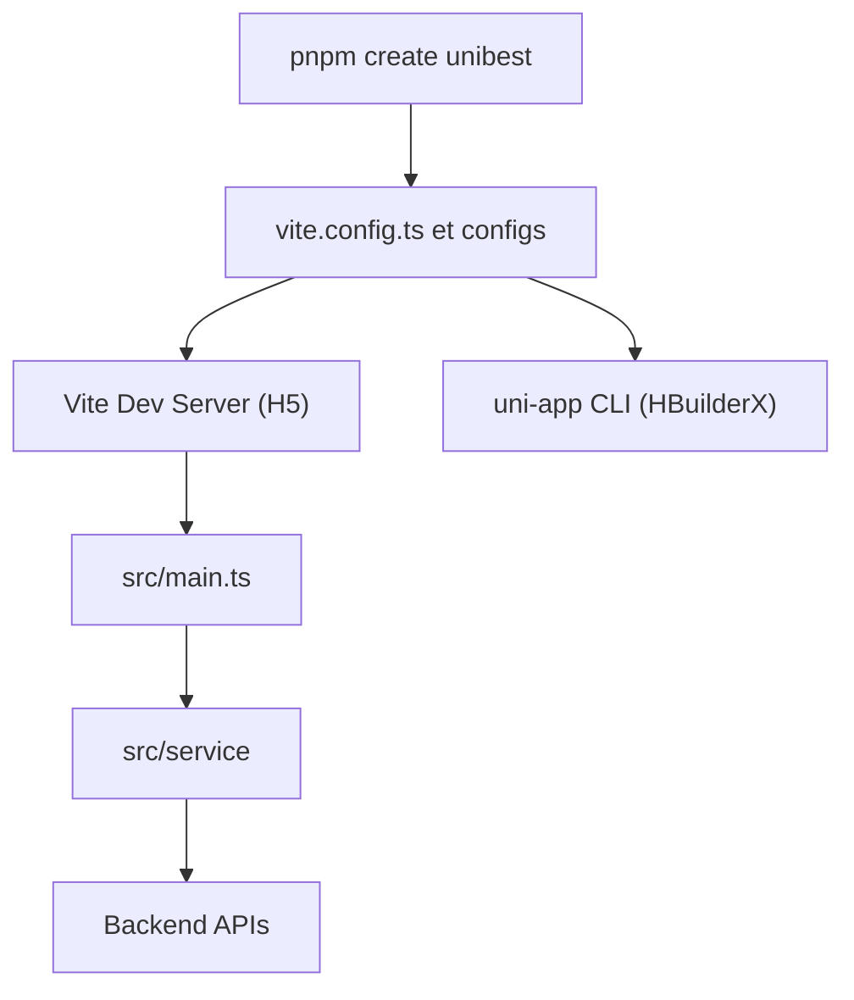

# feige996/unibest

> Modèle de projet uni-app (Vue 3, TypeScript, Vite) pour web, mini-programmes et applications mobiles.

## Le problème
Démarrer un projet uni-app multiplateforme oblige à assembler routage, requêtes, styles et outils sans HBuilderX.

## Ce que ça fait vraiment
Un gabarit uni-app avec Vue 3, TypeScript, Vite 5, UnoCSS, wot-ui et z-paging, lancé en ligne de commande. Il fournit routage par convention, layouts, encapsulation des requêtes, interception de connexion et i18n. Il cible H5, les mini-programmes (WeChat, Alipay, ByteDance et autres) et les applications. Le README est en chinois.

## Comment c'est branché


## Essayer
```bash
pnpm create unibest
pnpm i
pnpm dev
pnpm dev:mp
pnpm build:h5
```

## Coût et pièges
Gratuit. Il faut Node 18 ou plus et pnpm 7.30 ou plus ; les builds App passent par HBuilderX. Le dépôt a changé d'adresse : les PR vont sur feige996.

## Ce que ce n'est pas
Ce n'est pas un framework de plus : c'est un gabarit au-dessus d'uni-app. Les plateformes compatibles dépendent de la bibliothèque d'interface choisie.

## Alternatives
Aucune alternative nommée dans le README.

## Pour toi
À ignorer : utile seulement pour des mini-programmes chinois, sans lien avec un travail data, IA ou MLOps.

