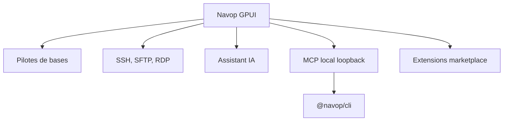

# feigeCode/navop

> Native Rust desktop client bringing together databases, SSH, SFTP, Redis, MongoDB and an AI assistant.

## The problem
Juggling a SQL client, an SSH terminal, an SFTP client and a Redis tool wastes time.

## What it actually does
A single application (GPUI interface) handles SQL with execution plans and ER diagrams, SSH terminals, SFTP/FTP files, RDP/VNC, Redis and MongoDB. It embeds an AI for SQL and a local MCP server (Safe, Confirm or Auto permissions) for external agents.

## How it is wired
Simplified diagram based on the sheet, no diagram provided.



## Trying it
```bash
npm install -g @navop/cli@latest
navop skill install --target codex --scope user
cargo run -p navop
```

## Cost and gotchas
Free binary; the AI features require a model provider. Optional Navop Cloud sync. License present but not identified by GitHub.

## What it is not
Not a library: it is a desktop application. The repository is very recent (July 2026) with 91 open issues, so maturity remains to be confirmed.

## Alternatives
No alternative named in the README.

## For you
Worth watching: handy for a data profile that touches SQL and SSH, but unclear license and a young project.
