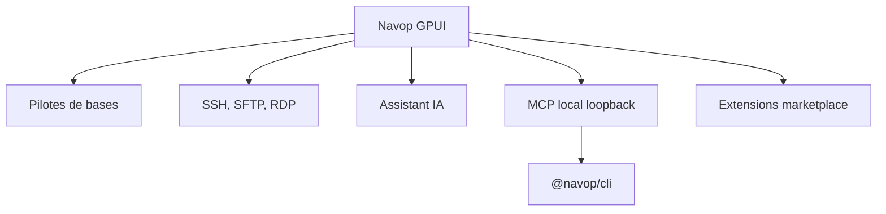

# feigeCode/navop

> Client de bureau natif en Rust réunissant bases de données, SSH, SFTP, Redis, MongoDB et assistant IA.

## Le problème
Jongler entre un client SQL, un terminal SSH, un client SFTP et un outil Redis fait perdre du temps.

## Ce que ça fait vraiment
Une seule application (interface GPUI) gère SQL avec plans d'exécution et diagrammes ER, terminaux SSH, fichiers SFTP/FTP, RDP/VNC, Redis et MongoDB. Elle embarque une IA pour le SQL et un serveur MCP local (permissions Safe, Confirm ou Auto) pour agents externes.

## Comment c'est branché
Schéma simplifié d'après la fiche, sans diagramme fourni.



## Essayer
```bash
npm install -g @navop/cli@latest
navop skill install --target codex --scope user
cargo run -p navop
```

## Coût et pièges
Binaire gratuit ; les fonctions IA demandent un fournisseur de modèle. Sync Navop Cloud optionnelle. Licence présente mais non identifiée par GitHub.

## Ce que ce n'est pas
Pas une bibliothèque : c'est une application de bureau. Le dépôt est très récent (juillet 2026) avec 91 issues ouvertes, la maturité reste à confirmer.

## Alternatives
Aucune alternative nommée dans le README.

## Pour toi
À surveiller : pratique pour un profil data qui touche SQL et SSH, mais licence floue et projet jeune.

