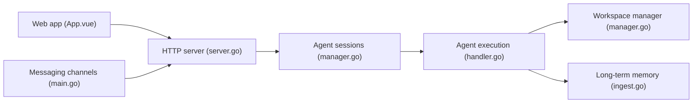

# felinics/Memoh

> Multi-agent platform where each agent has its own persistent cloud workstation with memory.

## The problem
Agents stay tied to your computer and forget context across platforms and sessions.

## What it actually does
Each agent has an isolated workspace (files, desktop, browser, network) managed by a container runtime, with long-term memory, scheduled tasks, MCP tools and connectors. You reach them through Telegram, Discord, Lark, WeChat or the web interface. Built-in agent with your keys, or hosted Claude Code and Codex. Sub-projects: Twilight AI (Go SDK), Connect It, UI.

## How it is wired


## Trying it
```bash
curl -fsSL https://memoh.sh | sh
```
```bash
git clone --depth 1 --recurse-submodules --shallow-submodules https://github.com/felinics/Memoh.git
cd Memoh
cp conf/app.docker.toml config.toml
export MEMOH_INTERNAL_RPC_SHARED_SECRET="$(openssl rand -hex 32)"
docker compose up -d
```

## Cost and gotchas
Self-hosted: your API keys and your server; Memoh Cloud (app.memoh.net) as an alternative with an account. The internal RPC secret must stay the same on every recreation. The "Project Status" section is empty in the README.

## What it is not
Not a simple chatbot: it orchestrates persistent machines, hence a wide attack surface. AGPL-3.0 license.

## Alternatives
No alternative named in the README.

## For you
Worth watching: interesting for always-on agents, but young (January 2026) and heavy to secure.
