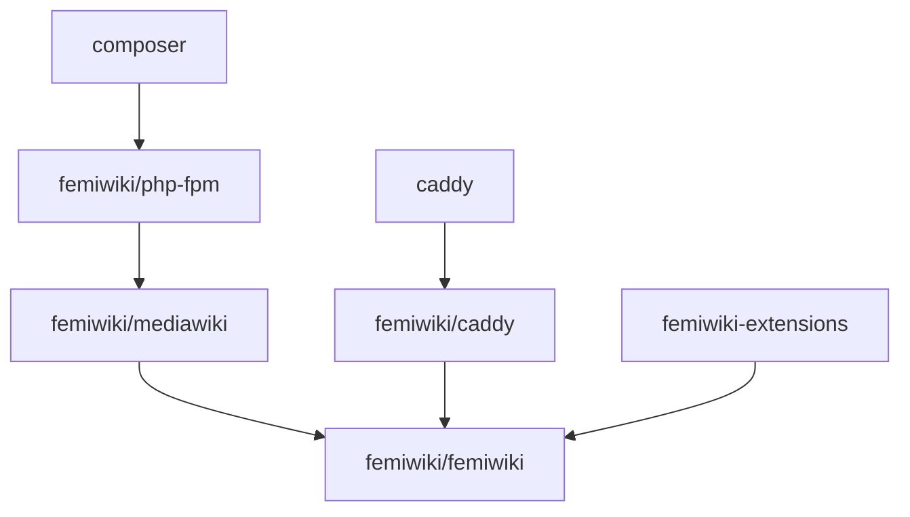

# femiwiki/docker-mediawiki

> MediaWiki Docker image specific to the FemiWiki site, with its settings and extensions, not to be reused elsewhere.

## The problem
The FemiWiki site needs a reproducible MediaWiki image with its extensions and configuration.

## What it actually does
The image provides a PHP-FPM server, and the same image can run the Caddy web server. A compose file launches everything with a database and memcached. Environment variables control installation and updates. The repository contains the Dockerfile and configuration tests via composer.

## How it is wired


## Trying it
```bash
docker swarm init
cp dockers/femiwiki/LocalSettings.php development/
cp dockers/femiwiki/Hotfix.php development/
docker compose -f compose.yaml up
docker build -t femiwiki/mediawiki:dev .
```

## Cost and gotchas
Docker required. The license present is not identified by GitHub, and the README cites AGPL v3: check before any use.

## What it is not
Not a generic image: the README itself advises against using it outside FemiWiki. The README is written mostly in Korean.

## Alternatives
The official MediaWiki Docker image, recommended by the README for general use.

## For you
Ignore: specific to one site and discouraged by its authors for any other use, with no link to data or AI.
