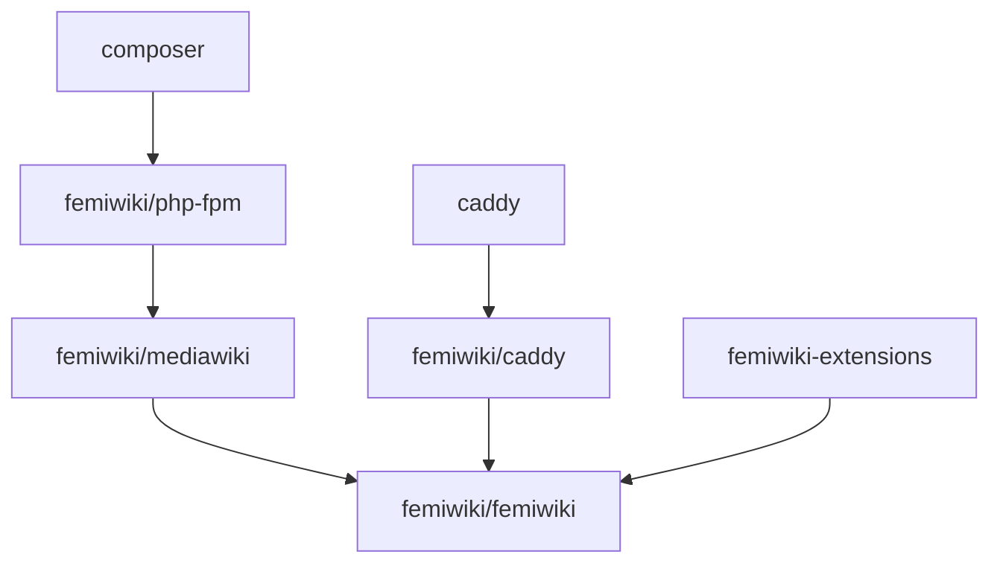

# femiwiki/docker-mediawiki

> Image Docker MediaWiki propre au site FemiWiki, avec ses réglages et extensions, à ne pas réutiliser ailleurs.

## Le problème
Le site FemiWiki a besoin d'une image MediaWiki reproductible avec ses extensions et sa configuration.

## Ce que ça fait vraiment
L'image fournit un serveur PHP-FPM, et le même image peut lancer le serveur web Caddy. Un fichier compose lance l'ensemble avec base de données et memcached. Des variables d'environnement contrôlent l'installation et les mises à jour. Le dépôt contient le Dockerfile et des tests de configuration via composer.

## Comment c'est branché


## Essayer
```bash
docker swarm init
cp dockers/femiwiki/LocalSettings.php development/
cp dockers/femiwiki/Hotfix.php development/
docker compose -f compose.yaml up
docker build -t femiwiki/mediawiki:dev .
```

## Coût et pièges
Docker requis. La licence présente n'est pas identifiée par GitHub, et le README cite l'AGPL v3 : à vérifier avant tout usage.

## Ce que ce n'est pas
Pas une image générique : le README déconseille lui-même de l'utiliser hors FemiWiki. Le README est écrit surtout en coréen.

## Alternatives
Image Docker officielle de MediaWiki, recommandée par le README pour un usage général.

## Pour toi
À ignorer : spécifique à un site et déconseillé par ses auteurs pour un autre usage, sans lien avec les données ou l'IA.

