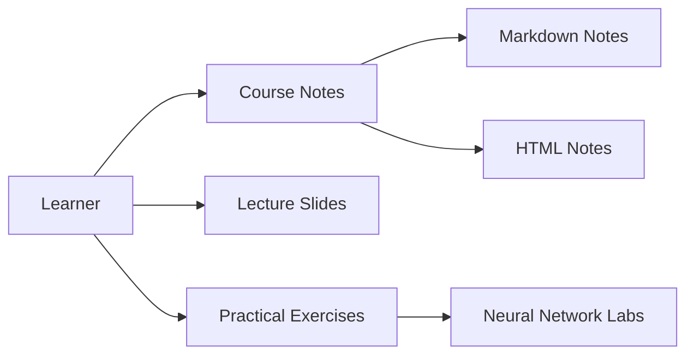

# fengdu78/Coursera-ML-AndrewNg-Notes

> Chinese-language notes for Andrew Ng's machine learning course (Stanford 2014), with slides, subtitles and notebooks.

## The problem
Following Andrew Ng's ML course in Chinese, with written materials and exercises.

## What it actually does
A content repository: notes in Markdown, HTML, Word and PDF, images, original slides, Chinese/English subtitles and Python code for the exercises (regression, classification, neural networks, SVM, clustering/PCA, anomaly detection, recommendation). Videos are on Baidu Cloud. No deployed application.

## How it is wired

## Trying it
No command documented in the README: you read the notes online or download the files.

## Cost and gotchas
Free. README and notes in Chinese; videos hosted on Baidu (access potentially difficult outside China).

## What it is not
Not an up-to-date course: it is the 2014 version (originally Octave/MATLAB). License: none, so reuse of the content is not explicitly authorized.

## Alternatives
No alternative named in the README.

## For you
Ignore unless you read Chinese and need ML basics; for an experienced profile, this is beginner-level content dated 2014.
