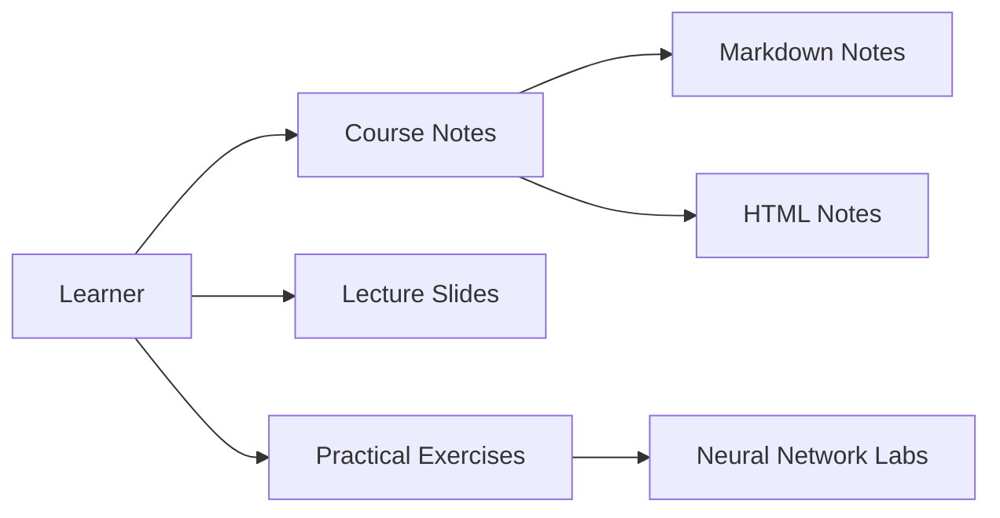

# fengdu78/Coursera-ML-AndrewNg-Notes

> Notes en chinois du cours de machine learning d'Andrew Ng (Stanford 2014), avec slides, sous-titres et notebooks.

## Le problème
Suivre le cours ML d'Andrew Ng en chinois, avec supports écrits et exercices.

## Ce que ça fait vraiment
Dépôt de contenu : notes en Markdown, HTML, Word et PDF, images, slides originaux, sous-titres chinois/anglais et code Python des exercices (régression, classification, réseaux de neurones, SVM, clustering/PCA, détection d'anomalies, recommandation). Les vidéos sont sur Baidu Cloud. Aucune application déployée.

## Comment c'est branché

## Essayer
Aucune commande documentée dans le README : on lit les notes en ligne ou on télécharge les fichiers.

## Coût et pièges
Gratuit. README et notes en chinois ; vidéos hébergées sur Baidu (accès potentiellement difficile hors Chine).

## Ce que ce n'est pas
Pas un cours à jour : c'est la version 2014 (Octave/MATLAB à l'origine). Licence aucune : réutilisation du contenu non autorisée explicitement.

## Alternatives
Aucune alternative nommée dans le README.

## Pour toi
À ignorer sauf lecture du chinois et besoin des bases ML ; pour un profil confirmé, c'est du contenu de niveau débutant, daté de 2014.

