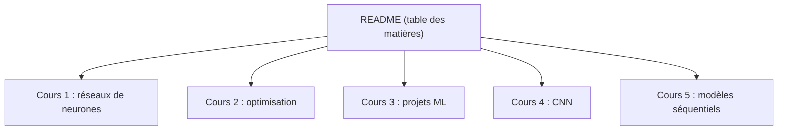

# fengdu78/deeplearning_ai_books

> Chinese-language notes for Andrew Ng's Deep Learning course, in five courses, for Chinese-speaking students.

## The problem
The Deep Learning specialization course is in English; a Chinese reader wants detailed notes.

## What it actually does
The README is a table of contents of the five courses (neural networks, improving networks, structuring projects, CNNs, sequence models), week by week, plus interviews (Hinton, Goodfellow, Bengio, Karpathy…) and a symbol guide. The content of the notes is not described: undocumented.

## How it is wired

## Trying it
No command: read the notes from the repository.

## Cost and gotchas
Free, but no license declared: reuse rights unknown. Notes from an old course (2017), without modern LLMs.

## What it is not
Not the official course nor executable code. Written in Chinese.

## Alternatives
No alternative named in the README.

## For you
Ignore: unless you read Chinese, the official course is more useful, and the lack of a license forbids reusing the content.
