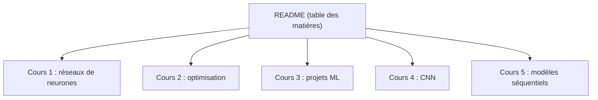

# fengdu78/deeplearning_ai_books

> Notes en chinois du cours Deep Learning d'Andrew Ng, en cinq cours, pour étudiants sinophones.

## Le problème
Le cours de spécialisation en apprentissage profond est en anglais ; un lecteur chinois veut des notes détaillées.

## Ce que ça fait vraiment
Le README est une table des matières des cinq cours (réseaux de neurones, amélioration des réseaux, projets structurés, CNN, modèles séquentiels), semaine par semaine, plus des entretiens (Hinton, Goodfellow, Bengio, Karpathy…) et un guide des symboles. Le contenu des notes n'est pas décrit : non documenté.

## Comment c'est branché

## Essayer
Aucune commande : lire les notes depuis le dépôt.

## Coût et pièges
Gratuit, mais aucune licence déclarée : droits de réutilisation inconnus. Notes d'un cours ancien (2017), sans LLM modernes.

## Ce que ce n'est pas
Pas le cours officiel ni du code exécutable. Rédigé en chinois.

## Alternatives
Aucune alternative nommée dans le README.

## Pour toi
Ignorer : sauf lecture du chinois, le cours officiel est plus utile, et l'absence de licence interdit de réutiliser le contenu.

