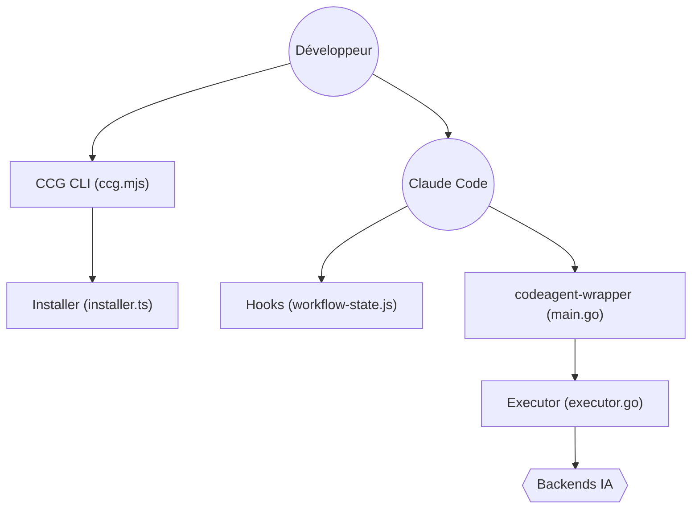

# fengshao1227/ccg-workflow

> Workflow engine for Claude Code that delegates analysis and review to other models (Codex, Gemini, etc.).

## The problem
A single model leaves blind spots, and Claude Code loses its context after compaction during long tasks.

## What it actually does
CCG installs slash commands, four JavaScript hooks that reinject the task state on every turn, and a Go binary (`codeagent-wrapper`) that relays work to external models. It picks among ten strategies depending on complexity, creates a `.ccg/tasks/` folder, enforces a stop for plan validation, then runs cross-reviews. It also offers skills (SEO, AdSense, BaoTa) and a plugin for DeepSeek Harness.

## How it is wired


## Trying it
```bash
npx ccg-workflow
npx ccg-workflow init --skip-prompt
npx ccg-workflow doctor
claude plugin marketplace add fengshao1227/ccg-workflow
```

## Cost and gotchas
Free, but each external model consumes your quota or your API key. Node.js 20+ and the Claude Code CLI are required; Codex, Grok, Kimi, Antigravity are optional. Multi-model commands only work through the npx installation, not through the native plugin.

## What it is not
Not a model nor an autonomous agent: Claude remains the conductor. The `doctor` diagnostic checks the configuration, not actual API access.

## Alternatives
No alternative cited in the README.

## For you
Worth watching if you work deeply with Claude Code; the repository is young (January 2026), run by a single person, and its value depends on multiplying your subscriptions.
