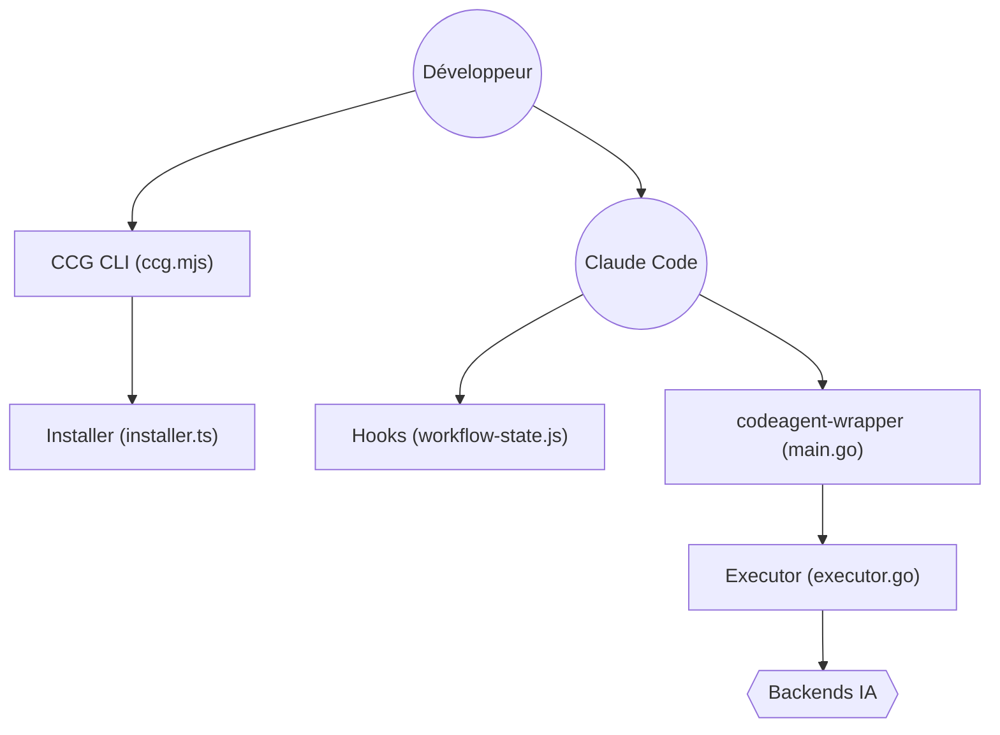

# fengshao1227/ccg-workflow

> Moteur de workflow pour Claude Code qui délègue analyse et revue à d'autres modèles (Codex, Gemini, etc.).

## Le problème
Un seul modèle laisse des angles morts et Claude Code perd son contexte après compaction pendant les longues tâches.

## Ce que ça fait vraiment
CCG installe des commandes slash, quatre hooks JavaScript qui réinjectent l'état de la tâche à chaque tour, et un binaire Go (`codeagent-wrapper`) qui relaie le travail vers des modèles externes. Il choisit parmi dix stratégies selon la complexité, crée un dossier `.ccg/tasks/`, impose un arrêt pour validation du plan, puis lance des revues croisées. Il propose aussi des skills (SEO, AdSense, BaoTa) et un plugin pour DeepSeek Harness.

## Comment c'est branché


## Essayer
```bash
npx ccg-workflow
npx ccg-workflow init --skip-prompt
npx ccg-workflow doctor
claude plugin marketplace add fengshao1227/ccg-workflow
```

## Coût et pièges
Gratuit, mais chaque modèle externe consomme ton quota ou ta clé d'API. Node.js 20+ et Claude Code CLI requis ; Codex, Grok, Kimi, Antigravity sont optionnels. Les commandes multi-modèles ne passent que par l'installation npx, pas par le plugin natif.

## Ce que ce n'est pas
Pas un modèle ni un agent autonome : Claude reste le chef d'orchestre. Le diagnostic `doctor` vérifie la configuration, pas l'accès réel aux API.

## Alternatives
Aucune alternative citée dans le README.

## Pour toi
À surveiller si tu travailles en profondeur avec Claude Code ; le dépôt est jeune (janvier 2026), porté par une seule personne, et la valeur dépend de la multiplication de tes abonnements.

