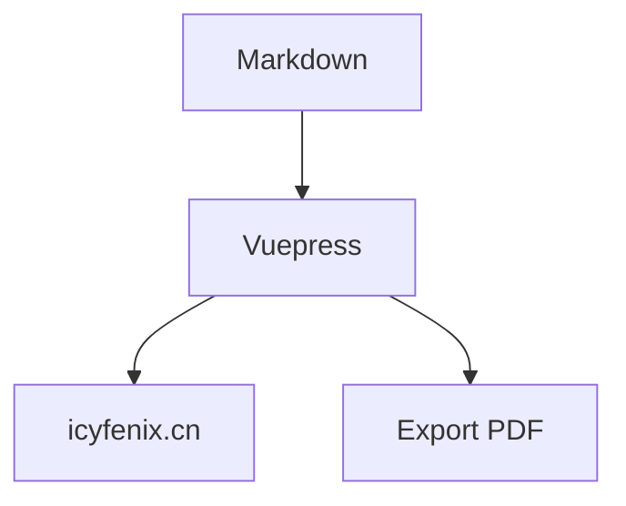

# fenixsoft/awesome-fenix

> Free book in Chinese on distributed systems architecture, with demo projects.

## The problem
Developers lack a structured map of modern architectures (monolith, microservices, service mesh, serverless).

## What it actually does
Vuepress documentation in Chinese, readable online at icyfenix.cn or self-hostable, exportable to PDF. Demo repositories accompany it: Spring Boot, Spring Cloud, Kubernetes, Istio, AWS Lambda. The text is under CC BY-NC-SA 4.0, the code under Apache 2.0, according to the README, although GitHub detects no license.

## How it is wired

Diagram inferred from the README.

## Trying it
```bash
git clone https://github.com/fenixsoft/awesome-fenix.git && cd awesome-fenix
npm install
npm run dev
npm run export
```

## Cost and gotchas
Free. License not detected by GitHub; commercial use of the text is excluded (NC). The PDF export takes about 25 minutes.

## What it is not
Not a framework or a tool. The content is in Chinese only and covers software architecture, not ML.

## Alternatives
No alternative named in the README.

## For you
Ignore: reading in Chinese on backend architecture, outside the data / AI profile, with an undeclared license.
