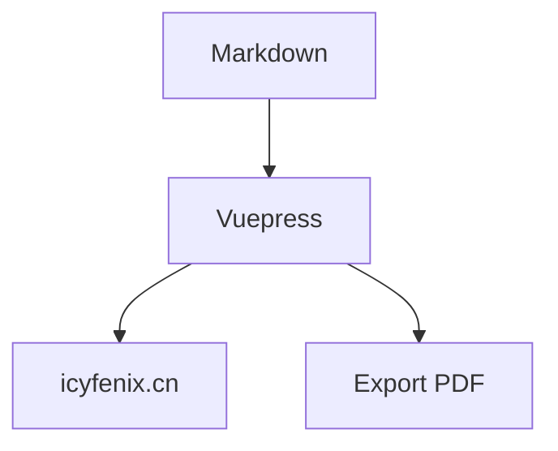

# fenixsoft/awesome-fenix

> Livre libre en chinois sur l'architecture de systèmes distribués, avec projets de démonstration.

## Le problème
Les développeurs manquent d'une carte structurée des architectures modernes (monolithe, microservices, service mesh, serverless).

## Ce que ça fait vraiment
Documentation Vuepress en chinois, lisible en ligne sur icyfenix.cn ou hébergeable en local, exportable en PDF. Des dépôts de démonstration l'accompagnent : Spring Boot, Spring Cloud, Kubernetes, Istio, AWS Lambda. Le texte est sous CC BY-NC-SA 4.0, le code sous Apache 2.0, selon le README, bien que GitHub ne détecte aucune licence.

## Comment c'est branché

Schéma déduit du README.

## Essayer
```bash
git clone https://github.com/fenixsoft/awesome-fenix.git && cd awesome-fenix
npm install
npm run dev
npm run export
```

## Coût et pièges
Gratuit. Licence non détectée côté GitHub ; l'usage commercial du texte est exclu (NC). L'export PDF prend environ 25 minutes.

## Ce que ce n'est pas
Pas un framework ni un outil. Le contenu est en chinois uniquement et porte sur l'architecture logicielle, pas sur le ML.

## Alternatives
Aucune alternative nommée dans le README.

## Pour toi
Ignorer : lecture en chinois sur l'architecture backend, hors profil data / IA, avec une licence non déclarée.

