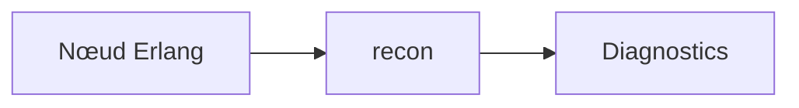

# ferd/recon

> Tools for diagnosing Erlang problems in production, for Erlang node operators.

## The problem
Inspecting an Erlang node in production without risking bringing it down.

## What it actually does
- A set of inspection functions designed for production.
- Compiled with Rebar3 (OTP 18.3 and later).
- Supported OTP versions: 18 and later; OTP 17 to R15B02 on a best-effort basis.
- Using tags rather than the development branch is recommended.
- Function details: not documented in the README (refers to the online docs).

## How it is wired

Diagram inferred from the library's purpose, not from a provided diagram.

## Trying it
```bash
rebar3 compile
```

## Cost and gotchas
Free. Use a stable tag rather than the main branch: the functions are designed to inspect an Erlang system in production, so handle them with care on a machine serving traffic.

## What it is not
Not a complete observability platform.

## Alternatives
No alternative named in the README.

## For you
Ignore: Erlang-specific, unrelated to data / AI.
