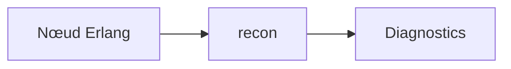

# ferd/recon

> Outils pour diagnostiquer en production des problèmes Erlang, pour exploitants de nœuds Erlang.

## Le problème
Inspecter un nœud Erlang en production sans risquer de le faire tomber.

## Ce que ça fait vraiment
- Jeu de fonctions d'inspection prévu pour la production.
- Compilation avec Rebar3 (OTP 18.3 et plus).
- Versions OTP supportées : 18 et plus ; OTP 17 à R15B02 au mieux.
- Il est conseillé d'utiliser les tags plutôt que la branche de développement.
- Détail des fonctions : non documenté dans le README (renvoi à la doc en ligne).

## Comment c'est branché

Schéma déduit de l'objet de la bibliothèque, pas d'un diagramme fourni.

## Essayer
```bash
rebar3 compile
```

## Coût et pièges
Gratuit. Utiliser un tag stable plutôt que la branche principale : les fonctions sont prévues pour inspecter un système Erlang en production, donc à manier avec prudence sur une machine qui sert du trafic.

## Ce que ce n'est pas
Pas une plateforme d'observabilité complète.

## Alternatives
Aucune alternative nommée dans le README.

## Pour toi
À ignorer : spécifique à Erlang, sans rapport avec data / IA.

