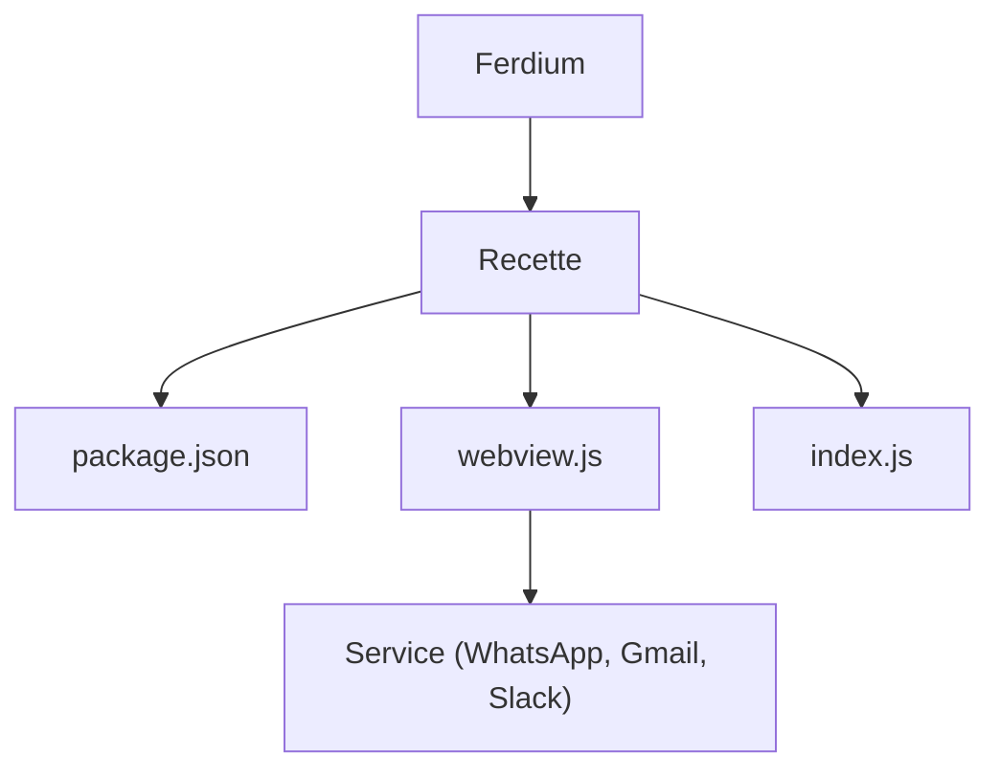

# ferdium/ferdium-recipes

> Small integration scripts that connect WhatsApp, Gmail, Slack and others to the Ferdium client.

## The problem
A messaging aggregator needs one connector per service to count notifications.

## What it actually does
Each recipe gives Ferdium the notification count, enables dark mode and adapts the service's experience. The README points to guides: create, update, configure (`package.json`), frontend API (`webview.js`) and backend API (`index.js`).

## How it is wired
Simplified diagram based on the sheet, no diagram provided.



## Trying it
```bash
pnpm validate
```

## Cost and gotchas
Free. The README is short. The real prerequisite (pnpm) comes from the only documented command.

## What it is not
Not an application: without Ferdium, these recipes are useless.

## Alternatives
No alternative named in the README.

## For you
Ignore: messaging connectors unrelated to your work.
