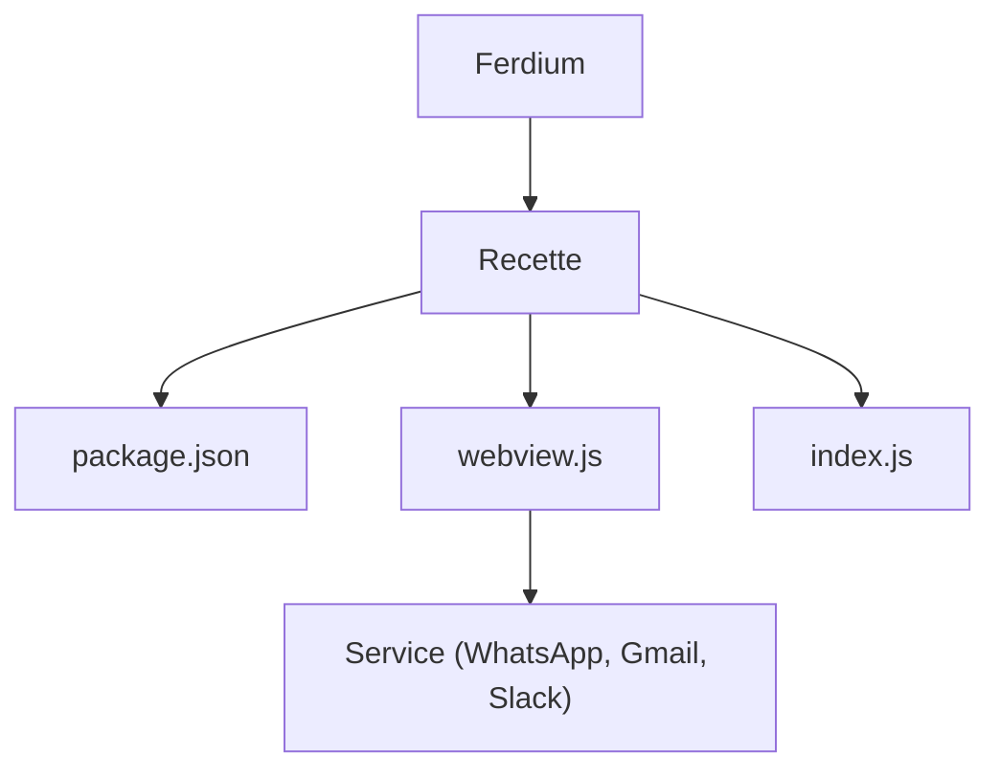

# ferdium/ferdium-recipes

> Petits scripts d'intégration qui relient WhatsApp, Gmail, Slack et autres au client Ferdium.

## Le problème
Un agrégateur de messageries a besoin d'un connecteur par service pour compter les notifications.

## Ce que ça fait vraiment
Chaque recette fournit à Ferdium le nombre de notifications, active le mode sombre et adapte l'expérience du service. Le README renvoie à des guides : créer, mettre à jour, configurer (`package.json`), API frontend (`webview.js`) et backend (`index.js`).

## Comment c'est branché
Schéma simplifié d'après la fiche, sans diagramme fourni.



## Essayer
```bash
pnpm validate
```

## Coût et pièges
Gratuit. Le README est court. Le prérequis réel (pnpm) vient de la seule commande documentée.

## Ce que ce n'est pas
Pas une application : sans Ferdium, ces recettes ne servent à rien.

## Alternatives
Aucune alternative nommée dans le README.

## Pour toi
Ignorer : connecteurs de messagerie sans lien avec ton métier.

