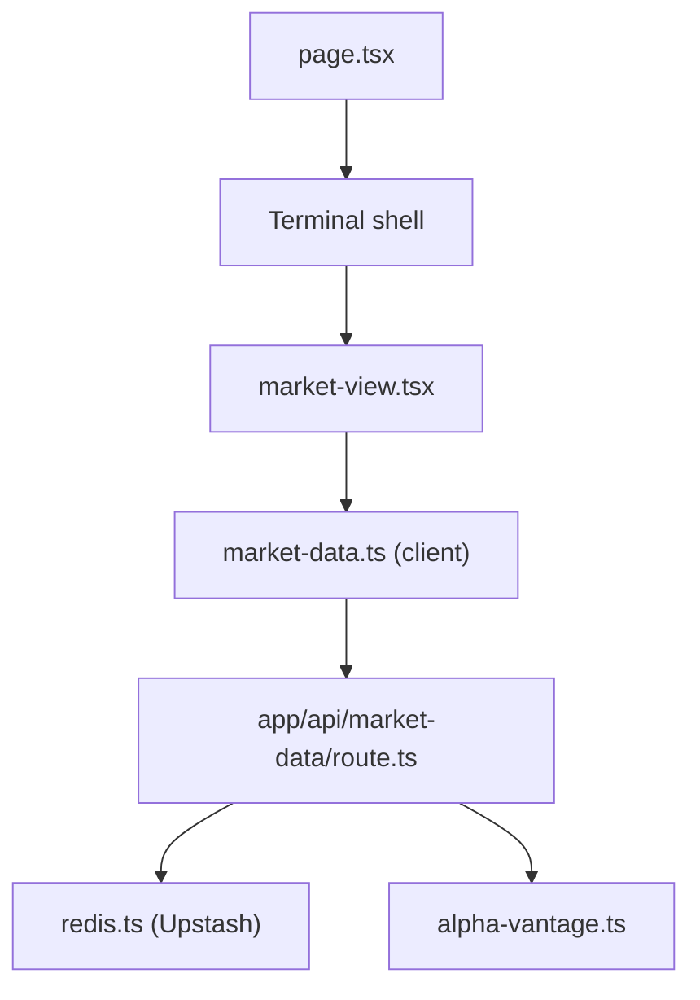

# feremabraz/bloomberg-terminal

> A Next.js clone of a Bloomberg terminal with simulated market data, for anyone who wants a financial interface demo.

## The problem
Financial terminal interfaces are hard to imitate: dense tables, constant updates, keyboard shortcuts.

## What it actually does
A single-page app with market, news, top movers, volatility and RMI analysis views. It handles a watchlist, a light or dark theme and shortcuts. The server delivers quotes from Alpha Vantage, fallback data and Redis; one route calls OpenAI for the analysis.

## How it is wired


## Trying it
```bash
# README : Node LTS + pnpm, puis un fichier .env.local avec
# UPSTASH_REDIS_REST_URL, UPSTASH_REDIS_REST_TOKEN,
# ALPHA_VANTAGE_API_KEY, OPENAI_API_KEY, ALLOWED_ORIGINS
# Aucune commande de lancement n'est donnée dans le README.
```

## Cost and gotchas
An Upstash account, an Alpha Vantage key and an OpenAI key are required (usage billed by them). No license declared: legal reuse is uncertain.

## What it is not
Not a Bloomberg terminal nor a trading tool: the data is simulated or comes from a free API. It is a front-end showcase.

## Alternatives
- No alternative named in the README.

## For you
Ignore: an interface demo with no license and no value for a data or MLOps pipeline.
