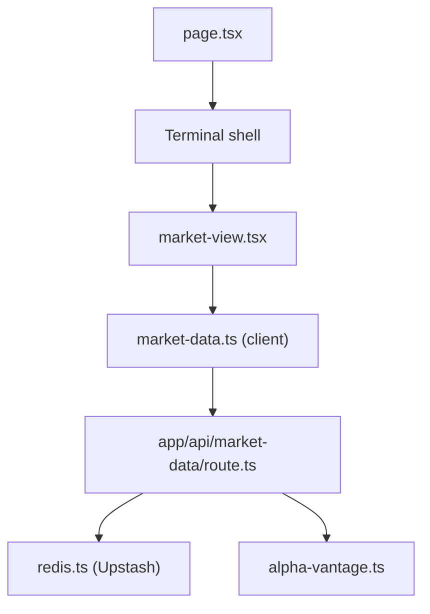

# feremabraz/bloomberg-terminal

> Clone en Next.js d'un terminal Bloomberg, avec données de marché simulées, pour qui veut une démo d'interface financière.

## Le problème
Les interfaces de terminaux financiers sont difficiles à imiter : tableaux denses, mises à jour constantes, raccourcis clavier.

## Ce que ça fait vraiment
Une appli monopage avec vues marché, actualités, plus fortes variations, volatilité et analyse RMI. Elle gère une liste de suivi, un thème clair ou sombre et des raccourcis. Le serveur sert les cotations depuis Alpha Vantage, des données de repli et Redis ; une route appelle OpenAI pour l'analyse.

## Comment c'est branché


## Essayer
```bash
# README : Node LTS + pnpm, puis un fichier .env.local avec
# UPSTASH_REDIS_REST_URL, UPSTASH_REDIS_REST_TOKEN,
# ALPHA_VANTAGE_API_KEY, OPENAI_API_KEY, ALLOWED_ORIGINS
# Aucune commande de lancement n'est donnée dans le README.
```

## Coût et pièges
Compte Upstash, clé Alpha Vantage et clé OpenAI nécessaires (usage facturé par eux). Aucune licence déclarée : réutilisation juridiquement incertaine.

## Ce que ce n'est pas
Pas un terminal Bloomberg ni un outil de trading : les données sont simulées ou issues d'une API gratuite. C'est une vitrine de front-end.

## Alternatives
- Aucune alternative nommée dans le README.

## Pour toi
À ignorer : démo d'interface sans licence ni valeur pour un pipeline data ou MLOps.

